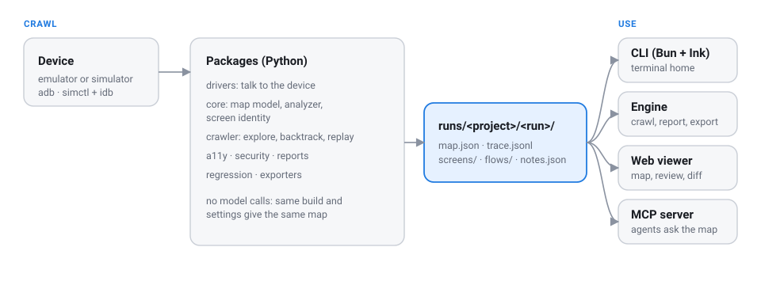

<p align="center">
  
</p>

<h1 align="center">AppScreenMap</h1>

<p align="center">
  <strong>Your AI agent maps and audits your mobile app. You review it in one dashboard.</strong><br>
  Ask in plain language. The agent crawls the app on an emulator or simulator, checks the result, runs the audits<br>
  and tunes what looks off. Everything lands in a built-in viewer you can read, triage and export.
</p>

<p align="center">
  <a href="https://github.com/MKS-01/appscreenmap/actions/workflows/crawler.yml"></a>
  <a href="https://github.com/MKS-01/appscreenmap/actions/workflows/web.yml"></a>
  
  
  
  <a href="LICENSE"></a>
</p>

<p align="center">
  <a href="#how-it-works-for-you">How it works</a> &nbsp;·&nbsp;
  <a href="#the-dashboard">Dashboard</a> &nbsp;·&nbsp;
  <a href="#export-and-share">Export</a> &nbsp;·&nbsp;
  <a href="#getting-started">Run it</a> &nbsp;·&nbsp;
  <a href="#commands">Commands</a> &nbsp;·&nbsp;
  <a href="docs/MAP_SCHEMA.md">Map format</a>
</p>

<p align="center"><sub>Deterministic crawler, no model calls. Plain files out. Early alpha.</sub></p>

---

Auditing a mobile app is a pile of manual jobs: tap through every screen, screenshot it, write a test per path,
run an accessibility scanner screen by screen, profile the slow ones, then repeat for the next release and paste
the results into a doc. AppScreenMap hands that work to your coding agent and keeps the results in one place.

## How it works for you

1. **Ask.** Tell your agent what you want, in plain language:

   > *Map my app on the emulator and review the map.*
   > *Audit accessibility on the latest run at WCAG 2.2 AA.*
   > *Crawl the new build and compare it with the last run.*
   > *Map sample-app on the iOS Simulator.*

2. **The agent does the work.** It checks the device, runs the crawl, reads the health report, and when something
   looks off (two screens merged, wasted taps, a failed route) it tunes the config and crawls again. Then it
   runs the accessibility and performance audits, and any audit you ask for.
3. **You review in the dashboard.** Run `appscreenmap serve` and everything is there: the map, every screen, the
   audits and their findings, the diff against the last build. No digging through run folders or opening
   reports one by one. Triage findings, then export a report to share.

The agent is Claude Code or any MCP client. The repo ships [skills](.claude/skills/) that teach it each job, and
an [MCP server](#agents-mcp) so it can ask the map ("how do I reach Settings?") instead of exploring the app
again. The crawler itself makes no model calls: same build and settings give the same map, so a regression is a
diff, not noise, and nothing leaves your machine.

### What the agent handles

| Job | What it does | Skill |
|---|---|---|
| **Map** | Installs the app, taps through buttons, tabs, lists and forms, records every screen and transition | [`crawl-app`](.claude/skills/crawl-app/SKILL.md) |
| **Review and tune** | Reads the health report; turns a bad crawl (merged screens, wasted taps) into a test and a fix, then re-crawls | [`tune-crawler`](.claude/skills/tune-crawler/SKILL.md) |
| **Accessibility** | WCAG 2.2 checks on every screen, plus the 200% text crawl, device checks and manual tests | [`a11y-audit`](.claude/skills/a11y-audit/SKILL.md), [`ios-a11y-rules`](.claude/skills/ios-a11y-rules/SKILL.md) |
| **Performance** | Load time, jank and cold start for every navigation, against a budget | built in |
| **Release checks** | Replays every path on a new build and diffs pixels and text, with CI exit codes | built in |
| **Security** | Gathers evidence from the build, judges it against the rule catalogue, writes it to the dashboard | [`security-audit`](.claude/skills/security-audit/SKILL.md) |
| **iOS setup** | Builds the app, boots the simulator, diagnoses a crawl that maps too little | [`ios-simulator`](.claude/skills/ios-simulator/SKILL.md) |
| **Tests** | Generates a [Maestro](https://maestro.mobile.dev) flow per screen; more E2E tools can be added | [`add-exporter`](.claude/skills/add-exporter/SKILL.md) |

## The dashboard

`appscreenmap serve` opens a viewer on your `runs/` folder. It has no backend and updates live while a crawl runs.

- **Insights**: the overview. One scored audit per row (accessibility, performance, stability, coverage and
  release readiness), sorted by what needs you first, each with charts and findings, the fix and its official source.
  Audits an agent writes (such as security) appear here automatically.
- **Map**: every screen shown whole, in Tree, Graph or Storyboard layouts. Click a screen to light up the path
  from launch.
- **Screens**: search titles, element text and resource-ids. Each screen shows tappable element overlays, its
  transitions, its Maestro flow and the raw hierarchy.
- **Accessibility**: findings grouped by rule, with a screenshot of each. Mark them *Needs fix*, *Won't fix* or
  *False positive*; the decisions are saved with the run (`notes.json`) and feed the WCAG report.
- **Compare**: match screens across two builds and see what changed.
- **Crawl replay**: step through the crawl to see what was tapped and why.
- **How it works**: the crawl loop, walked through on your own latest run.

Stars, notes and triage travel with the run folder. To work on the viewer, see [`web/README.md`](web/README.md).

## Export and share

| Export | Where | Format |
|---|---|---|
| Release-readiness summary: score, status and findings for every audit, with fixes and sources | Insights → *Export report* | Markdown |
| Accessibility findings, with your triage decisions | Accessibility → *Export Markdown* / *Export CSV* | Markdown, CSV |
| **WCAG 2.2 report**: a status for every A and AA criterion, findings with the fix and screenshot evidence | Accessibility → *View WCAG 2.2 report*, or `a11y-report.html` in the run | Self-contained HTML + Markdown twin |
| Maestro flows, one per screen | `flows/` in the run | YAML |
| Screen graph | `map.mmd` in the run | Mermaid |
| Everything, machine-readable | `map.json`, `a11y.json`, `perf.json` | JSON ([schema](docs/MAP_SCHEMA.md)) |

The WCAG report is written after every crawl, is one file you can attach to a ticket, and treats anything that
needs a person or a device as *Not tested*, never as a pass. It is evidence, not a conformance claim.

## Getting started

The quickest way is to ask your agent: *"Map my app on the emulator and review the map."* To run it yourself:

```bash
git clone https://github.com/MKS-01/appscreenmap && cd appscreenmap
uv sync
uv run appscreenmap doctor                       # checks adb, devices, simulators, idb, aapt2, viewer build
uv run appscreenmap crawl --apk path/to/app.apk  # Android: install + map
uv run appscreenmap serve                        # open the dashboard
```

Already installed? `crawl --package com.example.app --clear-data` maps it from a clean first-run state.

**iOS Simulator (beta).** Build the app for the simulator (`xcodebuild -sdk iphonesimulator`; an `.ipa` is
device-signed and won't run there), boot a simulator, then:

```bash
uv run appscreenmap crawl --platform ios --app path/to/YourApp.app --clear-data   # runs go to runs/<app>-ios/
```

| | |
|---|---|
| **Python** | 3.11 or newer, with [uv](https://docs.astral.sh/uv/) |
| **Android** | Platform-tools (`adb`) and a running emulator or USB device |
| **iOS** | macOS with Xcode, a booted simulator, and [idb](https://fbidb.io): `brew install facebook/fb/idb-companion` and `uv tool install fb-idb` |
| **Optional** | `aapt2` (build-tools) for activity coverage; [Bun](https://bun.sh) to rebuild the viewer; [Maestro](https://maestro.mobile.dev) to run the flows |

The repo ships two sample apps with their crawl results committed, so `serve` has something to show straight
after a clone: the **Playground** (every screen triggers a known feature, with v1 and v2 builds for release
comparisons) and **sample-app**, a real app crawled on Android and on the iOS Simulator. `samples/demo.sh` re-runs
every scenario; see [`samples/`](samples/).

### Platform support

| | Android (emulator or device) | iOS Simulator (beta) |
|---|---|---|
| Map, screenshots, patterns, form filling | ✅ | ✅ from the accessibility tree |
| Stays inside the app | ✅ lock task pinning | ✅ enforced by the explorer (restarts the app if it leaves) |
| Maestro flows, `diff`, `report`, dashboard, MCP map queries | ✅ | ✅ |
| WCAG 2.2 checks and report | ✅ | ✅ (iOS-specific rules next) |
| Resize-text crawl (`--font-scale 2.0`) | ✅ font scale | ✅ Dynamic Type |
| Crash capture | ✅ logcat | ✅ DiagnosticReports |
| Load time, jank, cold start | ✅ | not yet |
| `verify` on a new build, MCP `where_am_i` / `go_to_screen` | ✅ | not yet |

On iOS the crawler sees what VoiceOver sees: a control with no accessibility label isn't in the tree, so it can't be
tapped, and that is itself a finding. See the [`ios-simulator` skill](.claude/skills/ios-simulator/SKILL.md) and
[roadmap §8.3](docs/PLAN.md#83-ios-started).

## Commands

What the agent runs for you, and what you can run in CI or by hand. All run as `uv run appscreenmap <command>`;
`<run>` is a run folder such as `runs/sample-app/<run-id>`.

| Command | What it does |
|---|---|
| `doctor` | Check adb, devices, booted simulators, idb, aapt2 and the viewer build |
| `crawl --apk app.apk` / `--platform ios --app X.app` / `--package id` | Explore the app and write `runs/<project>/<run-id>/` |
| `serve` | Open the dashboard on `runs/` |
| `report <run>` | Health check: wasted taps, near-duplicate screens, navigation failures, and device conditions that skew results |
| `a11y <run> [--report]` | WCAG 2.2 checks; `--report` rebuilds `a11y-report.html` and `.md` |
| `perf <run> [--budget 1000]` | Load time per screen, slowest transitions, jank, cold start |
| `diff <base> <candidate>` | Match screens across two runs and diff pixels and text |
| `verify <run> [--apk new.apk]` | Replay every screen's path on a new build; exit 1 when one breaks ([CI](#ci-verify-a-new-build)). Android for now |
| `export <run>` | Regenerate Maestro flows and the Mermaid graph |
| `mcp` | Serve the maps to coding agents ([Agents](#agents-mcp)) |

Useful `crawl` flags: `--clear-data` (first-run state), `--max-steps`, `--max-minutes`, `--font-scale 2.0`
(WCAG 1.4.4 resize-text crawl), `--keep-animations` (load times as users see them), `--serial` (device serial
or simulator UDID), `--config appscreenmap.toml`.

## The audits

**Accessibility.** Findings are organised by WCAG 2.2 success criterion, with the Compose or View API to change
where there is one. It covers the criteria new in 2.2 (target size 2.5.8, dragging 2.5.7, focus not obscured
2.4.11, consistent help 3.2.6, redundant entry 3.3.7, accessible authentication 3.3.8) plus label in name, roles,
consistent navigation, orientation, truncated text and image alternatives. Automated checks catch only part of
WCAG; the `a11y-audit` skill covers the device and manual tests (rotation, keyboard, TalkBack), and
`ios-a11y-rules` maps WCAG to VoiceOver, Dynamic Type and Apple's 44 pt targets.

**Performance.** Rather than sleeping a fixed time after each tap, the crawler waits until the app stops drawing
(`dumpsys gfxinfo`), so every transition gets a load time, janky and frozen frames, and a note if a spinner never
went away. Cold start is recorded on every relaunch. Animations are off during a crawl for stable results
(`--keep-animations` measures what users see). Android only for now.

```
$ uv run appscreenmap perf runs/playground/<run-id> --budget 1000
  cold start: 151 ms median, 161 ms max over 11 launch(es)
   🔴  s018 'Reports'     2770 / 2770 / 2770  ×1  loading indicator, never settled
   🟠  s019 'Gallery'     1825 / 1825 / 1825  ×1  97.8% janky
   🟢  s005 'Article'      214 /  225 /  228  ×8
```

**Security.** The `security-audit` skill gathers evidence from the build (manifest or Info.plist, static scan,
data left on the device), judges it against the [`security-rules`](.claude/skills/security-rules/SKILL.md)
catalogue and writes the result into the run, so the Security audit in the dashboard shows real findings. For
builds you own or are authorised to test.

**Your own audits.** Any audit written to `runs/<project>/<run-id>/audits/<id>.json` shows up in Insights, scored
and exportable like the built-in ones ([format](docs/MAP_SCHEMA.md)).

## End-to-end tests

Every screen gets a [Maestro](https://maestro.mobile.dev) flow, on Android and iOS, that launches the app fresh,
follows the recorded path (typing into forms on the way) and asserts it arrived. Selectors prefer a resource-id,
then text or content description, and fall back to a position only when nothing else exists.

```yaml
# flows/s003.yaml (excerpt): reach s003 Search
appId: dev.appscreenmap.playground
---
- launchApp:
    stopApp: true
- tapOn: { id: "email" }
- inputText: "demo@playground.dev"
- tapOn: { id: "sign_in" }       # on s001
- tapOn: { id: "tab_search" }    # on s002
- assertVisible: { id: "tab_home" }
```

```bash
maestro test runs/<project>/<run-id>/flows/   # prove every screen is still reachable
```

AppScreenMap writes the files; it doesn't bundle or run Maestro (Apache-2.0, not affiliated). Maestro is the only
format today; more tools (Appium, Espresso, page objects) are planned behind a plug-in interface, and `map.json`
already has everything a generator needs.

### CI: verify a new build

```bash
uv run appscreenmap verify runs/sample-app/<run-id> --apk app-release.apk
```

`verify` replays every screen's path from a fresh launch on the new build (longest paths first). A path fails when
a step's element is gone, or it leads to the wrong screen, out of the app, or to a crash; screens behind it are
reported as blocked, and every screen it reaches is diffed against the base run.

```
✘ 9 passed, 1 failed, 1 blocked, 0 skipped · 2 visually changed   (1.3.0 vs base 1.2.0)
  ✘ s005 'Settings': 'Settings' is not on s002
  ⊘ s009 'Connect Notion': blocked by s005
  ≠ s002 'Hello, test': 0.84% pixels; text 1 changed
```

Exit codes: `0` all paths work, `1` a path broke (or a screen changed, with `--fail-on-change`), `2` bad arguments.
`--update-baselines` accepts the new look. Paths that can't work from a fresh launch even on the base build (reached
through app state, such as a running timer) are skipped with a note, not failed.

## Agents (MCP)

`appscreenmap mcp` serves your `runs/` to MCP clients such as Claude Code, so an agent can ask "how do I reach X",
"where am I" or "which screens fail WCAG" instead of exploring the app again.

```bash
claude mcp add appscreenmap -- uv run --directory /path/to/appscreenmap appscreenmap mcp
# options: --runs <dir> (default ./runs), --run <run-id> (default: latest finished), --serial <device>
```

| Tool | Answers |
|---|---|
| `list_runs`, `list_screens`, `find_screens` | What has been mapped; which screen is "Settings" or has a "Save" button |
| `get_screen`, `screenshot` | One screen: elements and where each leads, how to reach it, findings, load time, image |
| `route` | Steps to a screen, from launch or another screen (with the Maestro flow) |
| `where_am_i`, `go_to_screen` | Which screen the device shows now; drive it to another one |
| `a11y_findings`, `perf_summary` | Which screens fail which WCAG 2.2 criteria; which are slow |
| `crawl`, `crawl_status` | Map an app (or a new build) in the background |

## How the crawl works

<p align="center">
  
</p>

1. **Observe**: dump the UI hierarchy (the accessibility tree on iOS) and a screenshot, and read the foreground
   activity.
2. **Identify**: fingerprint the layout, ignoring list contents and digits (clocks, counters). Near-identical
   screens merge by similarity.
3. **Act**: pick the next untried element: bottom nav → tabs → buttons → scroll → list rows → toggles → back.
4. **Record** the transition and repeat. When a screen is exhausted, route back to the nearest screen with untried
   actions over the graph built so far, relaunching if needed.
5. **Stop** when nothing is left, the map saturates, or the budget runs out.

Along the way it:

- **Stays inside the app.** On Android the app is pinned (lock task mode), so BACK at the root or a link to another
  app can't leave it. iOS has no pinning, so the explorer treats any screen owned by another process (Safari, an
  in-app browser, a system sheet) as leaving. Either way it relaunches the app and never repeats that action.
- **Learns list patterns.** If the first rows of a list open the same kind of screen, the rest are skipped; menus
  whose rows go to different places are fully explored.
- **Infers navigation.** A bottom-nav item that opens *Saved* from one screen is assumed to do so everywhere.
- **Fills forms** from regex rules (email, password, phone, …) so login walls work.
- **Won't tap dangerous things**: log out, delete, pay, subscribe, uninstall, call… (configurable).
- **Handles system UI**: permission dialogs are allowed, crashes are recorded (logcat on Android, crash reports on iOS).

A small Python crawler drives the device: the **driver** (`adb` on Android, `simctl` + `idb` on the iOS Simulator)
dumps hierarchies, takes screenshots and sends taps; the **analyzer** turns a hierarchy into elements, a fingerprint
and UI patterns; the **explorer** picks the next action and records the transition. The iOS driver translates the
accessibility tree into the same hierarchy format, so the analyzer and explorer are shared. Everything else (the
dashboard, exporters, reports, `verify` and the MCP server) only reads the run folder, which is why `map.json` is the
contract in [`docs/MAP_SCHEMA.md`](docs/MAP_SCHEMA.md). Design and roadmap: [`docs/PLAN.md`](docs/PLAN.md).

## Configuration and secrets

Every option is in [`examples/appscreenmap.toml`](examples/appscreenmap.toml). Values the crawler types are recorded
so flows can replay them, so keep real credentials out by naming an environment variable:

```toml
[inputs]
"e-?mail|user" = "qa.tester@example.com"
"pass" = "${APP_PASSWORD}"
```

The crawler types the value of `APP_PASSWORD` but writes only `${APP_PASSWORD}` to `map.json` and the flows
(`maestro test -e APP_PASSWORD=… flow.yaml` fills it there). `crawl` and `verify` stop if a variable is unset, and
the crawl warns when it types a plain-text password.

## Output

```
runs/
  index.json                  all runs, newest first, grouped by project
  <project>/<run-id>/         e.g. runs/sample-app/sample-app-20261013-015149/
    map.json                  screens, elements, transitions, events, stats (live during the crawl)
    trace.jsonl               one line per step
    screens/                  s001.png (full), s001.jpg (thumbnail), s001.xml (hierarchy)
    flows/s001.yaml           Maestro flow: launch → … → assert this screen
    map.mmd                   Mermaid flowchart
    a11y.json, a11y-report.*  WCAG 2.2 findings and report
    perf.json                 load times, jank, cold start
    audits/<id>.json          extra audits written by an agent (security, …)
    notes.json                your stars, notes and triage decisions
    crashes/                  logcat for each crash
    diff/<base-run>/          diff against another run (written by `diff`)
    verify/<verify-id>/       replay results on a new build (written by `verify`)
```

Runs are grouped per project (`--project`, default: the last part of the package name; iOS runs add `-ios`, so they
never mix with the Android runs of the same app). The `runs/` folder is committed, so the repo ships sample maps of
the Playground and sample-app (Android and iOS).

## Project layout

```
src/appscreenmap/   crawler: drivers (Android, iOS Simulator), analyzer, explorer, model, export,
                    visual diff, a11y, perf, replay + verify, MCP server, CLI
web/                the dashboard (React + Vite, built with Bun)
design/             tokens.css: colour, type, space and motion for the viewer and reports
samples/            Playground and sample-app APKs, sources, iOS build script and demo.sh
runs/               committed sample crawls
docs/               PLAN.md (design + roadmap), MAP_SCHEMA.md (data contract)
examples/           sample config
tests/              unit tests on synthetic hierarchies (no device needed)
```

```bash
uv sync && uv run pytest -q
uv run ruff check src tests && uv run ruff format src
```

## Prior art

AppScreenMap builds on ideas from [DroidBot](https://github.com/honeynet/droidbot) (UI transition graphs),
[Fastbot](https://github.com/bytedance/Fastbot_Android) and [APE](https://github.com/tianxiaogu/ape) (model-based
exploration and state abstraction), Firebase Robo, and [Maestro](https://github.com/mobile-dev-inc/maestro) (flow
format). See [docs/PLAN.md](docs/PLAN.md#2-prior-art-what-we-borrow).

## Contributing

Issues and PRs are welcome. Start with [CONTRIBUTING.md](CONTRIBUTING.md); the data contract is
[`docs/MAP_SCHEMA.md`](docs/MAP_SCHEMA.md). Please follow the [code of conduct](CODE_OF_CONDUCT.md) and report
security problems privately ([SECURITY.md](SECURITY.md)).

**A note on privacy:** a crawl records what it types into forms and screenshots whatever the app shows. Use
throwaway test accounts and review `runs/` before you commit or share it.

## License

[MIT](LICENSE) © 2026 MKS and AppScreenMap contributors. Third-party notices (including the Lucide-derived icons in
the viewer) are in [THIRD_PARTY_NOTICES.md](THIRD_PARTY_NOTICES.md).

<p align="center">
  <sub>Early alpha: expect rough edges, and tell us about them</sub><br>
  <sub>Built agent-first with <a href="https://claude.ai/code">Claude Code</a></sub><br>
  <sub>sample-app, one of the sample apps, is <a href="https://github.com/MKS-01/sample-app">a separate project</a> by the same author</sub>
</p>
