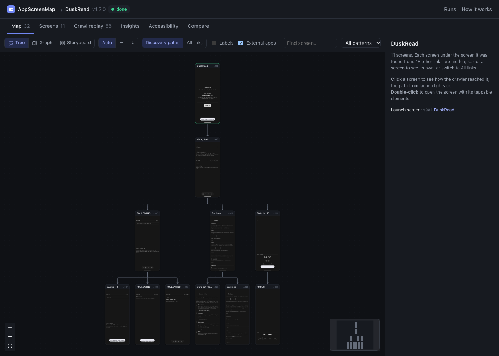
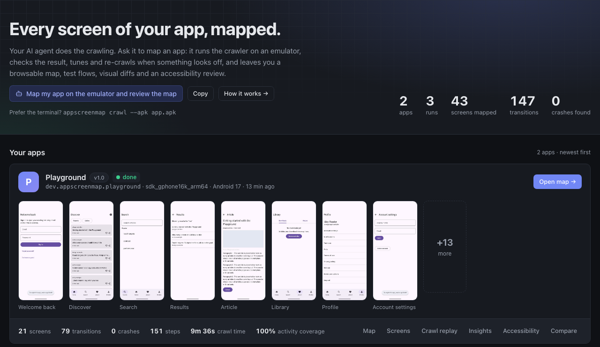
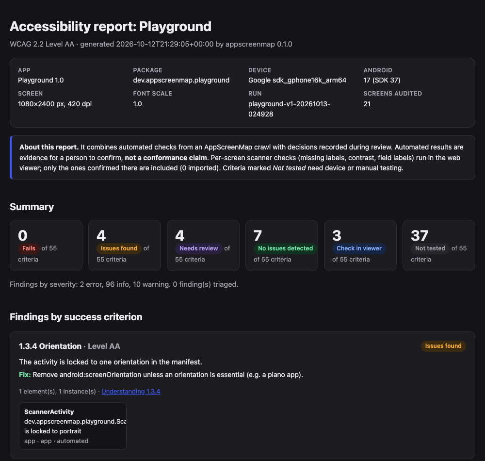
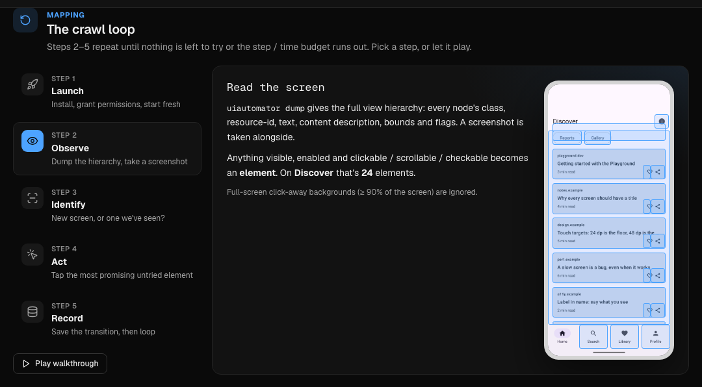

<p align="center">
  
</p>

<h1 align="center">AppScreenMap</h1>

<p align="center">
  <strong>Every screen of your app, mapped by an agent, not by hand.</strong><br>
  Point it at a build and an emulator. It taps through the app on its own and gives you<br>
  a map of every screen, how to reach it, and tests that jump straight there.
</p>

<p align="center">
  <a href="https://github.com/MKS-01/appscreenmap/actions/workflows/crawler.yml"></a>
  <a href="https://github.com/MKS-01/appscreenmap/actions/workflows/web.yml"></a>
  
  
  <a href="https://maestro.mobile.dev"></a>
  <a href="LICENSE"></a>
</p>

<p align="center">
  <a href="#what-it-does">What it does</a> &nbsp;·&nbsp;
  <a href="docs/PLAN.md">How it fits together</a> &nbsp;·&nbsp;
  <a href="#getting-started">Run it</a> &nbsp;·&nbsp;
  <a href="docs/MAP_SCHEMA.md">The map format</a>
</p>

<p align="center"><sub>Deterministic crawler, no model calls. Plain files out. Early alpha.</sub></p>

---

AppScreenMap installs your app, taps through it (buttons, tabs, lists, scrolling, forms) and
writes down what it finds: every screen, every transition between them, and the UI patterns on
each. Ask a coding agent to run it, and it checks the result, tunes and re-crawls when something
looks off, then leaves you a browsable map, test flows and accessibility findings.

## What it does

<p align="center">
  
</p>

- **Maps every screen.** A screenshot and view hierarchy for each unique screen, and every
  transition ("tap X on screen A opens screen B"). The patterns it finds are labelled: lists,
  tabs, bottom nav, forms, login, dialogs, webviews.
- **Writes the tests.** A [Maestro](https://maestro.mobile.dev) flow for each screen, so
  automation can jump straight there. More E2E tools are planned behind a plug-in interface.
- **Compares builds.** Visual diffs with pixels plus exact text changes from the view hierarchy;
  `verify` replays every path on a new build for CI.
- **Reviews accessibility and speed.** WCAG 2.2 checks across the crawl with a report you can
  triage, and load time, jank and cold start for every navigation.
- **Works with agents.** An MCP server lets coding agents ask the map instead of exploring the
  app again, and the repo ships skills so an agent knows how to crawl, tune and audit.
- **Stays in the app and out of trouble.** It never taps log out, delete, pay and the like, fills
  forms from your test-account config. Passwords can be `${ENV}` placeholders, so they never land in
  `map.json` or the flows ([Secrets](#secrets)).
- **Plain files.** `map.json` plus images, ready for the web viewer, your tooling, or a teammate
  exploring an unfamiliar app.

## Getting started

> **Android only for now.** iOS is planned, but it comes after the Android side is solid. The map format and
> viewer are platform-neutral, so an iOS driver can slot in later. See the [roadmap](docs/PLAN.md#8-roadmap).

```bash
git clone https://github.com/MKS-01/appscreenmap && cd appscreenmap
uv sync
uv run appscreenmap doctor                                         # checks adb, device, aapt2
uv run appscreenmap crawl --apk path/to/app.apk                    # install + map
uv run appscreenmap serve                                          # browse the result
```

Or have your agent do it: *"Map my app on the emulator and review the map."*

| | |
|---|---|
| **Python** | 3.11 or newer, with [uv](https://docs.astral.sh/uv/) |
| **Android** | Platform-tools (`adb`) and a running emulator or USB device |
| **Optional** | `aapt2` (Android SDK build-tools) for activity coverage; [Bun](https://bun.sh) to rebuild the viewer; [Maestro](https://maestro.mobile.dev) to run the generated flows |

<details>
<summary><strong>Map an app that's already installed</strong></summary>

```bash
uv run appscreenmap crawl --package com.example.app --clear-data   # clean first-run state
```
</details>

What a crawl looks like:

```
🗺  mapping DuskRead 1.2.0 on sdk_gphone16k_arm64 → runs/duskread-20261013-015149
  ↻ restart app (start)
  ★ new screen s001: 'DuskRead' [MainActivity] form
  ⌨ filled 1 field(s): EditText
[  2] s001 · click 'Get started'
  ★ new screen s002: 'Hello, test' [MainActivity] list,bottom_nav
[  4] s002 · click 'Following'
  ★ new screen s003: 'FOLLOWING' [MainActivity] list,bottom_nav,form
…
✔ nothing left to explore
✔ 11 screens, 36 transitions, 0 crashes, 95 steps in 350s
```


## Try it on the sample apps

Two sample apps ship with the repo ([`samples/`](samples/)): the **Playground**, built so every screen
triggers a known feature (with v1 and v2 builds for release comparisons), and **DuskRead**, a real Compose
app. Their APKs and crawl results are committed, so the viewer works straight after a clone.

```bash
uv run appscreenmap serve        # browse the committed sample maps
samples/demo.sh                  # re-run every scenario on your emulator (~25 min)
```

## Commands

| Command | What it does |
|---|---|
| `appscreenmap doctor` | Check adb, connected devices, aapt2, web viewer build |
| `appscreenmap crawl --apk app.apk` / `--package id` | Explore the app and write `runs/<project>/<project>-<timestamp>/` |
| `appscreenmap export runs/<project>/<run-id>` | Regenerate Maestro flows and the Mermaid graph |
| `appscreenmap a11y runs/<project>/<run-id> [--report]` | WCAG 2.2 checks across the crawl (target size 2.5.8, label in name, focusability, consistency, redundant entry, auth, …). `--report` writes `a11y-report.html` + `.md`: a status for every A/AA criterion, findings with screenshot evidence, and coverage. Both are also written after every crawl. |
| `appscreenmap perf runs/<project>/<run-id> [--budget 1000]` | Navigation performance: load time per screen (median/p90/max), slowest transitions, janky/frozen frames, cold start |
| `appscreenmap report runs/<project>/<run-id>` | Health check: wasted taps, near-duplicate screens, navigation failures |
| `appscreenmap diff runs/<base> runs/<candidate>` | Match screens across two runs and diff them: changed pixel regions (brighter/darker) and text added, removed, moved or changed, read from the hierarchy (no OCR) |
| `appscreenmap verify runs/<project>/<run-id> [--apk new.apk]` | Replay every screen's path on a new build. Exit 1 when a path breaks; failed steps get a screenshot. See [CI](#ci-verify-a-new-build) |
| `appscreenmap mcp` | Serve the maps to coding agents over MCP. See [Agents](#agents-mcp) |
| `appscreenmap serve` | Open the web viewer on `runs/` |

Useful `crawl` flags: `--clear-data` (map the first-run state), `--keep-animations` (load times as users see them), `--font-scale 2.0` (WCAG 1.4.4 resize-text crawl), `--max-steps`, `--max-minutes`,
`--settle`, `--serial`, `--config appscreenmap.toml`.

## Web viewer

`appscreenmap serve` opens a viewer for your `runs/` folder. It has no backend and updates live while a crawl runs.

<p align="center">
  
</p>

- **Map** in three layouts (Tree, Graph, Storyboard). Each screen is shown whole, at the device's own shape.
  Click one to light up the path from launch.
- **Screens** gallery with search over titles, element text and resource-ids; per-screen detail with tappable
  element overlays, transitions, the Maestro flow and the raw hierarchy.
- **Crawl replay**: step through the crawl to see what was tapped and why.
- **Insights**, an **Accessibility** review you can triage and export, and **Compare** for visual diffs between builds.

Stars, notes and accessibility decisions are saved next to the run (`notes.json`), so they travel with it.

The viewer is built with [Bun](https://bun.sh): `cd web && bun install && bun run build`, or `bun run dev` for
live reload. See [`web/README.md`](web/README.md) and the UI rules in [`web/DESIGN.md`](web/DESIGN.md).

## Accessibility report

<p align="center">
  
</p>

Every crawl writes `a11y-report.html` (self-contained, light and dark, easy to attach to a ticket) and an
`.md` twin. It is organised by **WCAG 2.2 success criterion**, not by a flat list of problems:

- **A status for every A and AA criterion.** Fails, Issues found, Needs review, No issues detected, Check in
  viewer, or **Not tested**. A criterion that needs a person or a device is shown as not tested, never as a pass,
  and the report says it is evidence, not a conformance claim.
- **Findings with the fix and the screenshot.** Each finding names the criterion, says what to change (with the
  Compose or View API where there is one), and shows the screen with the element highlighted.
- **The criteria that are new in WCAG 2.2**: target size (2.5.8), dragging alternatives (2.5.7), focus not
  obscured (2.4.11), consistent help (3.2.6), redundant entry (3.3.7) and accessible authentication (3.3.8).
  Others checked from the crawl include label in name (2.5.3), roles (4.1.2), consistent navigation (3.2.3),
  orientation (1.3.4), truncated text (1.4.4) and image alternatives (1.1.1).
- **Resize-text pass.** `crawl --font-scale 2.0` re-crawls at 200% text and records what truncates or clips.
- **Triage that feeds the report.** In the viewer you mark findings Needs fix, Won't fix or False positive. The
  decisions are saved in `notes.json` next to the run, and the report includes the ones you confirmed.

```bash
uv run appscreenmap a11y runs/<project>/<run-id> --report     # rebuild the report (level A/AA by default)
```

In the viewer it opens inside the Accessibility tab, with a separate Download button. Automated checks catch
only part of WCAG; the [`a11y-audit` skill](.claude/skills/a11y-audit/SKILL.md) covers the device and manual
tests (rotation, keyboard, TalkBack) the crawl can't do.

## Performance

Every transition is timed, so the crawl doubles as a speed survey of the app. Rather than sleeping a fixed
time, it waits until the app stops drawing (`dumpsys gfxinfo`), then records the **load time**, **janky and
frozen frames** and whether a loading spinner was still showing. Cold start is recorded on every relaunch.

```bash
uv run appscreenmap perf runs/<project>/<run-id> --budget 1000
```

```
Navigation performance for playground-v1-20261013-024928 (budget 1000 ms, animations off)
  cold start: 166 ms median, 187 ms max over 17 launch(es)
  screens, slowest first (median / p90 / max ms, samples):
   🔴  s018 'Reports'     2742 / 2752 / 2752  ×2  loading indicator, never settled
   🟠  s019 'Gallery'     1818 / 1826 / 1826  ×2  97.8% janky
   🟢  s005 'Article'      210 /  221 /  228  ×16
  findings:
    • s018 'Reports' never stopped drawing within the timeout (continuous animation or polling UI)
    • s019 'Gallery' renders janky: 97.8% slow frames
```

Screens are rated against your budget (green, orange, red) with median, p90 and max over every visit, and the
report lists the slowest transitions and a plain-language finding for each problem. The same numbers are in
`perf.json` and in the MCP `perf_summary` tool, so an agent can ask "which screens are slow" without re-crawling.
By default animations are switched off during a crawl for stable results; use `--keep-animations` to measure
load time as users see it.

## End-to-end tests

Every screen gets a ready-made [Maestro](https://maestro.mobile.dev) flow that launches the app fresh, follows
the recorded path (typing into forms on the way) and asserts it arrived:

```yaml
# excerpt of flows/s003.yaml
# AppScreenMap: reach s003 — Search
appId: dev.appscreenmap.playground
---
- launchApp:
    stopApp: true
- tapOn: { id: "email" }
- inputText: "demo@playground.dev"
- tapOn: { id: "sign_in" }       # on s001
- tapOn: { id: "tab_search" }    # on s002
- assertVisible: { id: "tab_home" }
```

Selectors prefer a stable resource-id, then text or content description, and fall back to a screen position only
when nothing else exists. Run one flow as a smoke test, or all of them to prove every screen is still reachable:

```bash
maestro test runs/<project>/<run-id>/flows/             # every screen
uv run appscreenmap verify runs/<project>/<run-id> --apk new.apk   # replay the paths on a new build, for CI
```

`verify` is the CI-friendly version: it replays every path on a new build, exits non-zero when one breaks, and
saves a screenshot of each failed step ([details](#ci-verify-a-new-build)).

**Maestro is the only test format exported today.** Letting you pick your own tool (Appium, Espresso, Playwright-style
page objects, or a custom template) through a plug-in interface is planned; until then the neutral `map.json`
has everything a generator needs. AppScreenMap writes the files and doesn't bundle or run Maestro.

## What's different

- **The crawl is deterministic and makes no model calls.** Same build, same settings, same map, so runs are
  comparable and a regression is a diff, not noise. An agent drives it; it doesn't improvise the crawl.
- **It maps first, then everything reads the map.** Tests, diffs, accessibility, performance, `verify` for CI
  and the MCP server all work from one plain `map.json`, so a coding agent can ask "how do I reach Settings"
  instead of exploring the app again.
- **Diffs read the view hierarchy, not just pixels.** Text added, removed, moved or changed is reported from the
  exact strings and positions on screen, with no OCR, next to the changed pixel regions.
- **Navigation is measured, not slept through.** It waits until the app stops drawing (`dumpsys gfxinfo`), so each
  transition gets a load time with jank and frozen frames, and cold start is recorded on every relaunch.
- **Safe by default.** The app stays pinned so the crawl can't wander off; it never taps log out, delete or pay;
  and test passwords can be `${ENV}` placeholders that never reach `map.json`.

## How it explores

<p align="center">
  
</p>

The viewer's **How it works** page walks through this loop on your own latest run.

1. **Observe**: dump the UI hierarchy and screenshot, and read the foreground activity.
2. **Identify the screen**: fingerprint the layout, ignoring list contents and digits (clocks,
   counters). Near-identical screens merge by similarity.
3. **Act**: pick the next untried element, in priority order: bottom nav → tabs → buttons →
   scroll → list rows → toggles → back.
4. **Record** the transition, then repeat. When a screen is exhausted, go back to the nearest
   screen with untried actions using the graph it has built. If that fails, relaunch the app
   and route again.
5. **Stop** when nothing is left, when the map saturates (no new screens for N steps), or when
   the budget runs out.

Built-in behavior:

- **Stays inside the app.** The app is pinned (Android lock task mode), so BACK on the home
  screen or a link to another app can't leave it. If something still escapes, it relaunches
  and never repeats that action.
- **Learns list patterns.** If the first two rows of a list open the same kind of screen,
  the rest are skipped. Menus whose rows go to different places are fully explored.
- **Infers navigation.** A bottom-nav item that goes to *Saved* from one screen is assumed to
  go there from every screen (recorded as an inferred edge).
- **Fills forms** on arrival using regex rules (email, password, phone, …), so login walls work.
  Put test credentials in the config as `${ENV}` placeholders (below), not as plain values.
- **Won't tap dangerous things**: log out, delete, pay, purchase, subscribe, uninstall, call…
  (configurable).
- **Handles system UI**: permission dialogs are allowed, and crashes are recorded with logcat.
- **Measures every navigation**: instead of fixed sleeps it waits until the app stops drawing
  (`dumpsys gfxinfo`), then records the load time, jank, and frozen frames for that transition. If a
  spinner is still showing, it waits for the content to arrive. Cold start time is recorded on every
  relaunch.

See [`examples/appscreenmap.toml`](examples/appscreenmap.toml) for every option.

## Output

```
runs/
  index.json          all runs (newest first), grouped by project
  <project>/<project>-<timestamp>/      e.g. runs/duskread/duskread-20261013-015149/
  map.json            screens, elements, transitions, events, stats (live-updated during the crawl)
  trace.jsonl         one line per step
  screens/            s001.png (full), s001.jpg (thumbnail), s001.xml (hierarchy)
  flows/s001.yaml     Maestro flow: launch → … → assert this screen
  map.mmd             Mermaid flowchart
  crashes/            logcat for each crash
  diff/<base-run>/    visual diff against another run (written by `diff` into the candidate)
  verify/<verify-id>/ replay results on a new build (written by `verify` into the base run)
```

Runs are grouped per project (`--project`, default: the last part of the package name).
The `runs/` folder is committed, so the repo ships sample maps (currently duskread).
The full format is documented in [`docs/MAP_SCHEMA.md`](docs/MAP_SCHEMA.md).

Flows use [Maestro](https://maestro.mobile.dev)'s YAML format. AppScreenMap only writes the files; install
Maestro (Apache-2.0, not bundled or affiliated) to run them:

```bash
maestro test runs/duskread/<run-id>/flows/s004.yaml
```

## Secrets

Values the crawler types are recorded so flows can replay them. Keep real credentials out of the run by
naming an environment variable instead:

```toml
[inputs]
"e-?mail|user" = "qa.tester@example.com"
"pass" = "${APP_PASSWORD}"
```

The crawler types the value of `APP_PASSWORD` but writes only `${APP_PASSWORD}` to `map.json` and the
Maestro flows (`maestro test -e APP_PASSWORD=… flow.yaml` fills it there too). `crawl` and `verify` stop
with an error if a variable is not set, and the crawl warns when it types a plain-text password.

## CI: verify a new build

```bash
uv run appscreenmap verify runs/duskread/<run-id> --apk app-release.apk
```

`verify` replays every screen's recorded path from a fresh launch on the new build (longest paths
first; screens passed along the way count as checked). A path fails when a step's element is gone, or
it leads to a different screen, out of the app, or to a crash. Screens behind a broken step are reported
as blocked. Screens whose recorded path can't work from a fresh launch even on the base build (reached
through app state, such as a running timer) are skipped with a note, not failed. Every screen it reaches
is diffed against the base run. Example output:

```
✘ 9 passed, 1 failed, 1 blocked, 0 skipped · 2 visually changed   (1.3.0 vs base 1.2.0)
  ✘ s005 'Settings': 'Settings' is not on s002
      evidence: runs/duskread/<run-id>/verify/verify-…/failed/s009.png
  ⊘ s009 'Connect Notion': blocked by s005
  ≠ s002 'Hello, test': 0.84% pixels; text 1 changed
```

Exit codes: `0` all paths work, `1` a path broke (or a screen changed, with `--fail-on-change`), `2`
bad arguments. `--update-baselines` accepts the new look: passed screens' screenshots and hierarchies
replace the base run's. Data is wiped before each path when the base run was crawled with `--clear-data`
(override with `--clear-data` / `--no-clear-data`).

## Agents (MCP)

`appscreenmap mcp` serves your `runs/` to MCP clients such as Claude Code, so an agent can ask the map
"how do I reach X", "where am I" or "which screens fail WCAG" instead of exploring the app again.
It needs the MCP SDK (the `mcp` extra; `uv sync` in a checkout installs it):

```bash
claude mcp add appscreenmap -- uv run --directory /path/to/appscreenmap appscreenmap mcp
# options: --runs <dir> (default ./runs), --run <run-id> (default: the latest finished run), --serial <device>
```

| Tool | Answers |
|---|---|
| `list_runs`, `list_screens`, `find_screens` | What has been mapped; which screen is "Settings" or has a "Save" button |
| `get_screen`, `screenshot` | One screen: elements and where each leads, how to reach it, a11y findings, load time, image |
| `route` | Steps to a screen, from launch or from another screen (with the Maestro flow) |
| `where_am_i` | Which map screen the device is showing now |
| `go_to_screen` | Drive the device there: recorded transitions from here, else relaunch and replay |
| `a11y_findings`, `perf_summary` | Which screens fail which WCAG 2.2 criteria; which screens are slow |
| `crawl`, `crawl_status` | Map an app (or a new build) in the background |

## How it's built

<p align="center">
  
</p>

A small Python crawler drives the device through `adb`: the **driver** dumps the view hierarchy and
screenshots and sends taps, the **analyzer** turns a hierarchy into elements, a screen fingerprint and
UI patterns, and the **explorer** chooses the next action, identifies the screen and records the
transition, backtracking over the graph it has built. It makes no model calls, so the same build and
settings give the same map. Everything it learns lands in one run folder, and everything else (the
[React viewer](web/README.md), the exporters, the accessibility, performance and diff reports, `verify`,
and the MCP server) only reads that folder, which is why `map.json` is the contract in
[`docs/MAP_SCHEMA.md`](docs/MAP_SCHEMA.md).

## Project layout

```
src/appscreenmap/   crawler (Python): driver, analyzer, explorer, model, export, visual diff,
                    replay + verify, MCP server, CLI
web/                web viewer (React + Vite)
docs/               PLAN.md (design + roadmap), MAP_SCHEMA.md (data contract)
examples/           sample config
tests/              unit tests (no device needed)
```

## Development

```bash
uv sync
uv run pytest -q
uv run ruff check src tests && uv run ruff format src
```

## Prior art

AppScreenMap builds on ideas from [DroidBot](https://github.com/honeynet/droidbot) (UI
transition graphs), [Fastbot](https://github.com/bytedance/Fastbot_Android) and
[APE](https://github.com/tianxiaogu/ape) (model-based exploration and state abstraction),
Firebase Robo, and [Maestro](https://github.com/mobile-dev-inc/maestro) (flow format).
See [docs/PLAN.md](docs/PLAN.md#2-prior-art-what-we-borrow).

## Contributing

Issues and PRs are welcome. Start with [CONTRIBUTING.md](CONTRIBUTING.md); the data contract is
[`docs/MAP_SCHEMA.md`](docs/MAP_SCHEMA.md). Please follow the [code of conduct](CODE_OF_CONDUCT.md), and report
security problems privately ([SECURITY.md](SECURITY.md)).

**A note on privacy:** a crawl records what it types into forms and screenshots whatever the app shows. Use
throwaway test accounts and review `runs/` before you commit or share it.

## License

[MIT](LICENSE) © 2026 MKS and AppScreenMap contributors. Third-party notices (including the Lucide-derived icons
in the viewer) are in [THIRD_PARTY_NOTICES.md](THIRD_PARTY_NOTICES.md).

<p align="center">
  <sub>Early alpha: expect rough edges, and tell us about them</sub><br>
  <sub>Built agent-first with <a href="https://claude.ai/code">Claude Code</a></sub><br>
  <sub>Sample maps are of <a href="https://github.com/MKS-01/duskread">DuskRead</a>, a separate project by the same author</sub>
</p>
