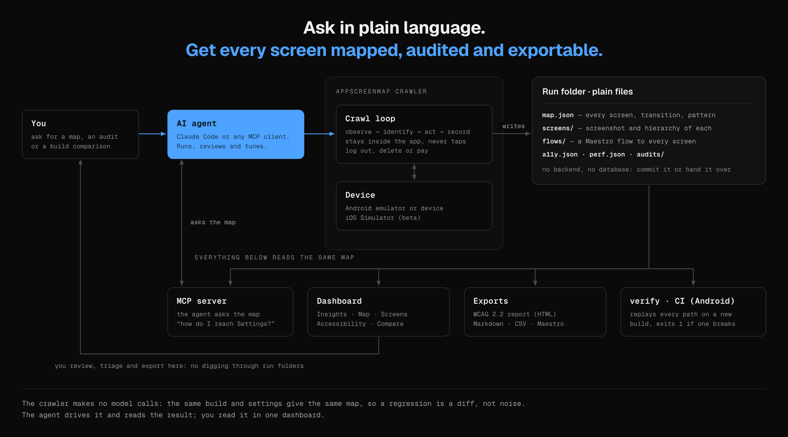

<p align="center">
  
</p>

<h1 align="center">AppScreenMap</h1>

<p align="center">
  <strong>Map and audit any mobile app by crawling it, from your AI agent over MCP. No SDK, no test IDs, no source.</strong><br>
  Point it at a build on an Android emulator or iOS Simulator. You get plain files, ready-to-run test flows,<br>
  WCAG and performance audits, a CI gate, and a live dashboard to browse it all.
</p>

<p align="center">
  <a href="https://github.com/MKS-01/appscreenmap/actions/workflows/crawler.yml"></a>
  
  <a href="#mcp-server"></a>
  <a href="LICENSE"></a>
</p>

<p align="center">
  <a href="#why">Why</a> ·
  <a href="#get-started">Get started</a> ·
  <a href="#how-it-works">How it works</a> ·
  <a href="#use-it-with-an-agent">Agent</a> ·
  <a href="#mcp-server">MCP</a> ·
  <a href="#dashboard">Dashboard</a> ·
  <a href="docs/SETUP.md">Docs</a>
</p>

<p align="center">
  
</p>

```bash
appscreenmap crawl --apk app.apk   # explore the app, then run `appscreenmap` to browse the map
```

> [!NOTE]
> **Early alpha.** Commands and flags may change. iOS and the security audit (18 of 19 rules) are beta (see [Feature status](#feature-status)).

## Why

Ask a team "how many screens does your app have, and how do I reach checkout?" and you get a guess. The answer
lives in someone's head, a stale design file, or a test suite that breaks every sprint. AppScreenMap crawls the
build you already ship and writes it down, so the answer is a file you can query, diff and build on.

| You get | Which means |
|---|---|
| **A complete screen inventory** | Know what is in the build, including screens nobody remembers |
| **Routes to every screen** | "How do I reach Settings?" is a lookup, for you and for your agent |
| **A diff between builds** | Added, removed and changed screens before release, not after |
| **Crawl on Android and iOS** | One command explores the build on an emulator or Simulator, no scripting |
| **Exports you can use** | Test flows, one per screen (Maestro format), a Mermaid graph, a one-file SVG map you can drop into Figma, a WCAG report |
| **WCAG 2.2 and performance audits** | Every screen checked, with the fix and an official source |
| **A CI gate** | `verify` replays every path on a new build and fails the job if one breaks |
| **An MCP server for your agent** | Your agent knows the app without re-exploring it: find a screen, get the route, go there |

And it asks nothing of your app:

- **Zero app changes.** No SDK, no test IDs, no source. Works on any mobile app, native or cross-platform (Jetpack
  Compose, React Native, SwiftUI), even with almost no resource ids.
- **Deterministic.** No model calls in the crawl: same build and config, same map, so a regression is a diff.
- **Local and safe.** Nothing leaves your machine. It stays in the app and never taps log out, delete or pay.
- **Agent-native.** A local [MCP server](#mcp-server) and [skills](.claude/skills/) for Claude Code or any MCP client.

## Get started

Needs macOS, [uv](https://docs.astral.sh/uv/), [Bun](https://bun.sh), and an Android emulator or device (`adb`),
or Xcode with a booted Simulator for iOS.

```bash
git clone https://github.com/MKS-01/appscreenmap && cd appscreenmap
make install                         # engine, dashboard and the `appscreenmap` command
appscreenmap setup                   # checks adb, devices, simulators; says what is missing
appscreenmap crawl --apk app.apk     # explore the app
appscreenmap                         # terminal home + dashboard
```

No app handy? Press `x` in the terminal home to map the [Playground](samples/README.md) sample app.
Output is a run folder of plain files (`map.json`, `screens/`, `flows/`, `a11y.json`, `perf.json`, reports);
`map.json` is a versioned contract, see [docs/MAP_SCHEMA.md](docs/MAP_SCHEMA.md).

## How it works

1. **Drive.** The engine talks to the device over `adb` (Android) or `simctl` + `idb` (iOS Simulator), pinned to
   your app so a crawl cannot wander into other apps.
2. **Observe.** Each step captures a screenshot and the UI hierarchy (`uiautomator` on Android).
3. **Identify.** The analyzer fingerprints the layout and ignores list contents and digits (clocks, counters), so a
   list with new rows is the same screen and a different layout is a new one. That keeps the map stable across runs.
4. **Act.** The explorer picks the next tap, scroll or text entry. It recognises tabs, lists, forms, dialogs and
   login screens, and skips destructive actions (log out, delete, pay).
5. **Record.** Screens and transitions go to `map.json`; the audits read the same files.

Your agent sits above this loop: it starts runs, reads the health report, fixes config and re-crawls.
See [docs/ARCHITECTURE.md](docs/ARCHITECTURE.md) for the details.

## Use it with an agent

Press `t` in the terminal home for a new terminal in the same folder, run `claude`, and ask in plain language:

> *Map my app on the emulator and review the map.*
> *Audit accessibility on the latest run at WCAG 2.2 AA.*
> *Crawl the new build and compare it with the last run.*
> *The last crawl merged two screens. Fix it and crawl again.*

Its work shows up live in the dashboard.

| Job | Skill |
|---|---|
| Map and review a crawl | [`crawl-app`](.claude/skills/crawl-app/SKILL.md), [`tune-crawler`](.claude/skills/tune-crawler/SKILL.md) |
| Accessibility (WCAG 2.2) | [`a11y-audit`](.claude/skills/a11y-audit/SKILL.md) |
| iOS Simulator setup | [`ios-simulator`](.claude/skills/ios-simulator/SKILL.md) |
| Store deadlines (Play target API, App Store SDK) | [`store-requirements`](.claude/skills/store-requirements/SKILL.md) |
| Test export | [`add-exporter`](.claude/skills/add-exporter/SKILL.md) |

## MCP server

> *You:* How do I reach Settings?<br>
> *Agent → `route("Settings")`:* From launch: tap **Profile**, then tap **Settings**. Here is the test flow.<br>
> *You:* Take the emulator there.<br>
> *Agent → `go_to_screen("Settings")` → `where_am_i()`:* Done, the device is on Settings.

`appscreenmap mcp` serves your mapped runs to any MCP client (Claude Code, Claude Desktop, Cursor, VS Code, …). The
map becomes the agent's memory of the app, so it answers from the map instead of exploring the app again. It is a
local stdio server: it reads `runs/` on your machine and talks to your emulator or Simulator, with no account, no
API key and no network calls.

```bash
claude mcp add appscreenmap -- appscreenmap mcp
```

Other clients take the same command in their MCP config:

```json
{ "mcpServers": { "appscreenmap": { "command": "appscreenmap", "args": ["mcp"] } } }
```

Options: `--runs <dir>` (default `./runs`), `--run <run-id>` (default: the latest finished run), `--serial <device>`.

| Tool | Answers | Kind |
|---|---|---|
| `list_runs`, `list_screens`, `find_screens` | What has been mapped; which screen is "Settings" or has a "Save" button | read-only |
| `get_screen`, `screenshot` | One screen: elements and where each leads, how to reach it, findings, load time, image | read-only |
| `route` | Steps to a screen, from launch or another screen (with its test flow) | read-only |
| `a11y_findings`, `perf_summary` | Which screens fail which WCAG 2.2 criteria; which are slow | read-only |
| `where_am_i` | Which mapped screen the device shows now | read-only |
| `go_to_screen` | Drive the device to a screen along its route | drives the device |
| `crawl`, `crawl_status` | Map an app (or a new build) in the background, and follow it | drives the device |

Tools carry MCP annotations (`readOnlyHint`, `destructiveHint`), so clients can ask before the two that drive the
device. More in [docs/SETUP.md](docs/SETUP.md#agents-mcp).

## Dashboard

`appscreenmap serve` opens it on `runs/`. No backend; it updates live during a crawl.

- **Insights**: scored audits with findings, fixes and official sources
- **Map**: every screen as a tree, graph or storyboard
- **Screens**: search, tappable overlays, transitions, the test flow
- **Accessibility**: findings per rule with screenshots; triage them, export a WCAG 2.2 report
- **Compare**: what changed between two builds
- **Crawl replay**: step through what was tapped and why

Export Markdown or CSV from the dashboard, or take the files straight from the run: test flows (`flows/`, Maestro format), a
Mermaid graph (`map.mmd`), a one-file WCAG report (`a11y-report.html`, evidence not a conformance claim), and
`map.json` / `a11y.json` / `perf.json` for your own tooling.

## Commands

| Command | Does |
|---|---|
| `crawl --apk app.apk` | Install and explore (`--clear-data` for first run, `--config` for logins) |
| `report <run>` | Crawl health: wasted steps, merged screens |
| `a11y <run> --report` | WCAG 2.2 checks and report |
| `perf <run>` | Load time, jank, cold start |
| `security <run> --apk app.apk` | Manifest, code, secrets and data-at-rest checks (`--app` for an iOS build) |
| `store [run] --apk app.apk` · `--app App.ipa` | Target / compile / min SDK (Android) or build SDK and deployment target (iOS) against Google Play and App Store rules, with every deadline in the next 365 days. A crawl writes it too |
| `export <run> --svg` | The whole map as one SVG (`--layout tree\|graph\|storyboard`, `--theme light\|dark`): opens in a browser, drag it into Figma |
| `diff <run> <run>` | Visual diff of two runs: added, removed and changed screens |
| `verify <run> --apk new.apk` | Replay every path on a new build; exit codes for CI |
| `merge --into <canvas> <run>` | Add a run to the app's canvas as a scenario |
| `doctor` · `logs` | Check adb, devices and tools · follow what every command is doing |
| `serve` · `mcp` | Dashboard · MCP server |

Run as `appscreenmap <command>`. More: `appscreenmap --help`, [docs/SETUP.md](docs/SETUP.md).

After pulling new code, run `make install` again to rebuild the `appscreenmap` command. The agent skills from Google's
[android/skills](https://github.com/android/skills) stay current with `make skills-check` and `make skills-sync`, and
Apple's Xcode 27 skills with `make skills-xcode`.

## Feature status

| Feature | Status | What you get |
|---|---|---|
| Android crawl and screen map | ✅ Ready | Every screen and route from an emulator or device, without leaving your app |
| Dashboard | ✅ Ready | Map, screens, crawl replay and build compare, live while it crawls |
| Accessibility audit | ✅ Ready | WCAG 2.2 findings with screenshots, fixes and a shareable report |
| Performance | ✅ Ready | Load time per screen, jank and cold start |
| `verify` CI gate | ✅ Ready | Replays every path on a new build and fails the job if one breaks |
| Exports | ✅ Ready | Test flows (Maestro format), Mermaid graph and a one-file SVG of the map |
| MCP server and agent skills | ✅ Ready | Ask your AI agent to map, audit and compare |
| Store readiness | ✅ Ready | Play and App Store SDK deadlines for the next 365 days |
| iOS Simulator crawl | 🧪 Beta | Same map on iOS; see the [`ios-simulator`](.claude/skills/ios-simulator/SKILL.md) skill |
| Security audit | 🧪 Beta | 18 of 19 rules on Android and iOS builds; see the [`security-audit`](.claude/skills/security-audit/SKILL.md) skill |

Audit rules (WCAG, security, Play and App Store) are updated as the official guidance changes.

## License

Open source under the [MIT License](LICENSE). © 2026 MKS and AppScreenMap contributors.

Built with [Claude Code](https://claude.com/claude-code).
