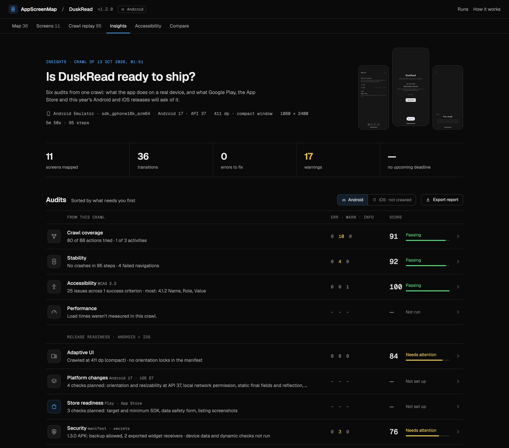

<p align="center">
  
</p>

<h1 align="center">AppScreenMap</h1>

<p align="center">
  <strong>Every screen of your mobile app, mapped end to end by your AI agent.</strong><br>
  Point it at a build. It crawls the app on an emulator or simulator and writes a complete map of every screen<br>
  and how to reach it. Tests, regression checks, audits and docs all build on that map, in one dashboard.
</p>

<p align="center">
  <a href="https://github.com/MKS-01/appscreenmap/actions/workflows/crawler.yml"></a>
  <a href="https://github.com/MKS-01/appscreenmap/actions/workflows/web.yml"></a>
  
  
  
  <a href="LICENSE"></a>
</p>

<p align="center">
  <a href="#why-appscreenmap">Why</a> &nbsp;·&nbsp;
  <a href="#how-it-works-for-you">How it works</a> &nbsp;·&nbsp;
  <a href="#the-dashboard">Dashboard</a> &nbsp;·&nbsp;
  <a href="#export-and-share">Export</a> &nbsp;·&nbsp;
  <a href="#quick-start">Run it</a> &nbsp;·&nbsp;
  <a href="#docs">Docs</a>
</p>

<p align="center"><sub>Deterministic crawler, no model calls. Plain files out. Early draft.</sub></p>

---

> [!NOTE]
> **Early draft.** AppScreenMap is early alpha and still taking shape: commands, flags and screens may change, the
> iOS Simulator support is beta, and the security scanner covers Android only (its Frida script hasn't been run on
> a device yet). Expect rough edges, and please open an issue when you hit one.

Every mobile team needs to know what is in its app: which screens exist, how you reach each one, and what changed
in this build. Today that lives in someone's head, an out-of-date diagram or a hand-written test suite.
AppScreenMap has your coding agent crawl the app and write that map for you. Everything else is built on it:
generated test flows, regression checks between builds, accessibility and performance audits, exports, and
answers for the agent itself ("how do I reach Settings?"). The map is the product; the audits are one use of it.

<p align="center">
  
  <br>
  <sub>The Insights page of the built-in dashboard, for the DuskRead sample app. The first four rows come from an Android crawl (v1.2.0); the Security row is <code>appscreenmap security</code> run on the DuskRead 1.3.0 APK.</sub>
</p>

## Why AppScreenMap

- **One crawl, many uses.** The map of every screen is the foundation. Test flows, regression checks, audits, exports
  and the agent's own answers all read it, so there is no separate tool for each job.
- **Your agent runs it, you review it.** Ask in plain language; the agent crawls, reviews, tunes and audits, and
  everything lands in one dashboard instead of a trail of run folders and reports.
- **Nothing to add to your app.** No SDK, no test IDs, no source access: it drives the build you ship through `adb`
  (or `simctl` and `idb` on iOS), and copes with apps that expose almost no resource ids, such as Compose.
- **Deterministic and local.** The crawler makes no model calls, so the same build and settings give the same map and
  a regression is a diff, not noise. Nothing leaves your machine.
- **Safe by default.** It stays inside the app, never taps log out, delete or pay, keeps passwords out of the output
  (`${ENV}` placeholders), and never writes a secret it finds into a finding.
- **Standards, with sources.** Accessibility is checked per WCAG 2.2 criterion, and every finding cites official
  Android, Apple or W3C documentation. Anything that needs a person or a device is "Not tested", never a pass.
- **Open files, two platforms.** MIT-licensed plain files, with `map.json` a documented, versioned contract any tool
  can read, for Android and the iOS Simulator alike.

## How it works for you

<p align="center">
  
</p>

1. **Ask.** Tell your agent what you want, in plain language:

   > *Map my app on the emulator and review the map.*
   > *Audit accessibility on the latest run at WCAG 2.2 AA.*
   > *Crawl the new build and compare it with the last run.*
   > *Map DuskRead on the iOS Simulator.*

2. **The agent does the work.** It checks the device, runs the crawl, reads the health report, and when something
   looks off (two screens merged, wasted taps, a failed route) it tunes the config and crawls again. Then it
   generates the test flows and runs whatever else you asked for: audits, a comparison with the last build, a
   check that a new build still reaches every screen.
3. **You review in the dashboard.** Run `appscreenmap serve` and everything is there: the map, every screen, the
   test flows, the audits and their findings, the diff against the last build. No digging through run folders or opening
   reports one by one. Triage findings, then export a report to share.

The agent is Claude Code or any MCP client. The repo ships [skills](.claude/skills/) that teach it each job, and
an [MCP server](docs/SETUP.md#agents-mcp) so it can ask the map ("how do I reach Settings?") instead of exploring the app
again. The crawler itself makes no model calls: same build and settings give the same map, so a regression is a
diff, not noise, and nothing leaves your machine.

### What the agent handles

| Job | What it does | Skill |
|---|---|---|
| **Map** | Installs the app, taps through buttons, tabs, lists and forms, records every screen and transition | [`crawl-app`](.claude/skills/crawl-app/SKILL.md) |
| **Review and tune** | Reads the health report; turns a bad crawl (merged screens, wasted taps) into a test and a fix, then re-crawls | [`tune-crawler`](.claude/skills/tune-crawler/SKILL.md) |
| **Accessibility** | WCAG 2.2 checks on every screen, plus the 200% text crawl, device checks and manual tests | [`a11y-audit`](.claude/skills/a11y-audit/SKILL.md), [`ios-a11y-rules`](.claude/skills/ios-a11y-rules/SKILL.md) |
| **Performance** | Load time, jank and cold start for every navigation, against a budget | built in |
| **Release checks** | Replays every path on a new build and diffs pixels and text, with CI exit codes | built in |
| **Security** | `appscreenmap security` scans an Android build for exported components, cleartext traffic, hard-coded secrets and plain-text data on the device, and writes the findings to the dashboard | [`security-audit`](.claude/skills/security-audit/SKILL.md) |
| **iOS setup** | Builds the app, boots the simulator, diagnoses a crawl that maps too little | [`ios-simulator`](.claude/skills/ios-simulator/SKILL.md) |
| **Tests** | Generates a [Maestro](https://maestro.mobile.dev) flow per screen; more E2E tools can be added | [`add-exporter`](.claude/skills/add-exporter/SKILL.md) |

## The dashboard

`appscreenmap serve` opens a viewer on your `runs/` folder. It has no backend and updates live while a crawl runs.

- **Insights**: the overview. One scored audit per row (accessibility, performance, stability, coverage and
  release readiness), sorted by what needs you first, each with charts and findings, the fix and its official source.
  Audits an agent writes (such as security) appear here automatically.
- **Map**: every screen shown whole, in Tree, Graph or Storyboard layouts. Click a screen to light up the path
  from launch.
- **Screens**: search titles, element text and resource-ids. Each screen shows tappable element overlays, its
  transitions, its Maestro flow and the raw hierarchy.
- **Accessibility**: findings grouped by rule, with a screenshot of each. Mark them *Needs fix*, *Won't fix* or
  *False positive*; the decisions are saved with the run (`notes.json`) and feed the WCAG report.
- **Compare**: match screens across two builds and see what changed.
- **Crawl replay**: step through the crawl to see what was tapped and why.
- **How it works**: the crawl loop, walked through on your own latest run.

Stars, notes and triage travel with the run folder. To work on the viewer, see [`web/README.md`](web/README.md).

## Export and share

| Export | Where | Format |
|---|---|---|
| Release-readiness summary: score, status and findings for every audit, with fixes and sources | Insights → *Export report* | Markdown |
| Accessibility findings, with your triage decisions | Accessibility → *Export Markdown* / *Export CSV* | Markdown, CSV |
| **WCAG 2.2 report**: a status for every A and AA criterion, findings with the fix and screenshot evidence | Accessibility → *View WCAG 2.2 report*, or `a11y-report.html` in the run | Self-contained HTML + Markdown twin |
| Maestro flows, one per screen | `flows/` in the run | YAML |
| Screen graph | `map.mmd` in the run | Mermaid |
| Everything, machine-readable | `map.json`, `a11y.json`, `perf.json` | JSON ([schema](docs/MAP_SCHEMA.md)) |

The WCAG report is written after every crawl, is one file you can attach to a ticket, and treats anything that
needs a person or a device as *Not tested*, never as a pass. It is evidence, not a conformance claim.

## Quick start

Ask your agent: *"Map my app on the emulator and review the map."* Or run it yourself:

```bash
git clone https://github.com/MKS-01/appscreenmap && cd appscreenmap
uv sync
uv run appscreenmap doctor                       # checks adb, devices, simulators, idb, viewer build
uv run appscreenmap crawl --apk path/to/app.apk  # Android: install + map
uv run appscreenmap serve                        # open the dashboard
```

On the iOS Simulator (beta): `crawl --platform ios --app path/to/YourApp.app`. Python 3.11+ with
[uv](https://docs.astral.sh/uv/) and an Android emulator or a booted simulator are all you need. Two sample apps
ship in [`samples/`](samples/); `samples/demo.sh` crawls them so the dashboard has something to show.

## Docs

| | |
|---|---|
| [Setup and usage](docs/SETUP.md) | Requirements, Android and iOS, platform support, every command and flag, config and secrets, Maestro tests, CI `verify`, MCP |
| [Architecture](docs/ARCHITECTURE.md) | The crawl loop, the audits, the run folder, project layout |
| [Map format](docs/MAP_SCHEMA.md) | The `map.json` contract the viewer and tools read |
| [Plan and roadmap](docs/PLAN.md) | Design rationale, prior art, what's next |
| [Samples](samples/README.md) | The Playground and DuskRead apps and the demo scenarios |

## License

[MIT](LICENSE) © 2026 MKS and AppScreenMap contributors.
