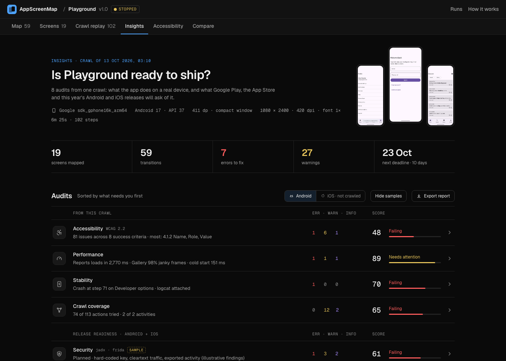

<p align="center">
  
</p>

<h1 align="center">AppScreenMap</h1>

<p align="center">
  <strong>Every screen of your app, mapped by an agent, not by hand.</strong><br>
  Point it at a build and an emulator. It taps through the app on its own and gives you<br>
  a map of every screen, how to reach it, and tests that jump straight there.
</p>

<p align="center">
  <a href="https://github.com/MKS-01/appscreenmap/actions/workflows/crawler.yml"></a>
  <a href="https://github.com/MKS-01/appscreenmap/actions/workflows/web.yml"></a>
  
  
  <a href="https://maestro.mobile.dev"></a>
  <a href="LICENSE"></a>
</p>

<p align="center">
  <a href="#getting-started">Run it</a> &nbsp;·&nbsp;
  <a href="#web-viewer">Viewer</a> &nbsp;·&nbsp;
  <a href="#commands">Commands</a> &nbsp;·&nbsp;
  <a href="#how-it-works">How it works</a> &nbsp;·&nbsp;
  <a href="docs/MAP_SCHEMA.md">Map format</a>
</p>

<p align="center"><sub>Deterministic crawler, no model calls. Plain files out. Early alpha.</sub></p>

---

AppScreenMap installs your app, taps through it (buttons, tabs, lists, scrolling, forms) and writes down
what it finds: every screen, every transition between them, and the UI patterns on each. Ask a coding agent
to run it and it checks the result, tunes and re-crawls when something looks off, then leaves you a
browsable map, test flows, and accessibility and performance findings.

<p align="center">
  
</p>

## What it does

- **Maps every screen.** A screenshot and view hierarchy for each unique screen, every transition ("tap X on
  A opens B"), and labelled patterns: lists, tabs, bottom nav, forms, login, dialogs, webviews.
- **Writes the tests.** A [Maestro](https://maestro.mobile.dev) flow per screen, so automation can jump
  straight there. `verify` replays every path on a new build for CI.
- **Compares builds.** Changed pixel regions plus exact text changes read from the view hierarchy (no OCR).
- **Audits accessibility and speed.** WCAG 2.2 checks with a report you can triage; load time, jank and cold
  start for every navigation.
- **Works with agents.** An MCP server lets coding agents ask the map instead of exploring the app again,
  and the repo ships [skills](.claude/skills/) so an agent knows how to crawl, tune and audit.
- **Deterministic and safe.** Same build and settings give the same map, so a regression is a diff, not
  noise. The app stays pinned, it never taps log out, delete or pay, and test passwords can be `${ENV}`
  placeholders that never reach the output.

## Getting started

> **Android first, iOS Simulator started.** `crawl --platform ios --app YourApp.app` maps an app on a booted simulator
> (needs `idb`: see `doctor`). The map format and viewer are platform-neutral. See the [roadmap](docs/PLAN.md#8-roadmap).

```bash
git clone https://github.com/MKS-01/appscreenmap && cd appscreenmap
uv sync
uv run appscreenmap doctor                     # checks adb, device, aapt2, viewer build
uv run appscreenmap crawl --apk path/to/app.apk  # install + map
uv run appscreenmap serve                      # browse the result
```

Already installed? `crawl --package com.example.app --clear-data` maps it from a clean first-run state.
Or have your agent do it: *"Map my app on the emulator and review the map."*

| | |
|---|---|
| **Python** | 3.11 or newer, with [uv](https://docs.astral.sh/uv/) |
| **Android** | Platform-tools (`adb`) and a running emulator or USB device |
| **Optional** | `aapt2` (build-tools) for activity coverage; [Bun](https://bun.sh) to rebuild the viewer; [Maestro](https://maestro.mobile.dev) to run the flows |

A crawl looks like this:

```
🗺  mapping DuskRead 1.2.0 on sdk_gphone16k_arm64 → runs/duskread/duskread-20261013-015149
  ↻ restart app (start)
  ★ new screen s001: 'DuskRead' [MainActivity] form
  ⌨ filled 1 field(s): EditText
[  2] s001 · click 'Get started'
  ★ new screen s002: 'Hello, test' [MainActivity] list,bottom_nav
…
✔ nothing left to explore
✔ 11 screens, 36 transitions, 0 crashes, 95 steps in 350s
```

### Sample apps

Two apps ship in [`samples/`](samples/) with their APKs and crawl results committed, so the viewer works
straight after a clone: the **Playground**, built so every screen triggers a known feature (with v1 and v2
builds for release comparisons), and **DuskRead**, a real Compose app.

```bash
uv run appscreenmap serve   # browse the committed sample maps
samples/demo.sh             # re-run every scenario on your emulator (~25 min)
```

## Web viewer

`appscreenmap serve` opens a viewer for your `runs/` folder. It has no backend and updates live while a
crawl runs.

<p align="center">
  
</p>

- **Map** in three layouts (Tree, Graph, Storyboard), each screen shown whole at the device's shape. Click one
  to light up its path from launch.
- **Screens**: search titles, element text and resource-ids; per-screen detail with tappable element
  overlays, transitions, the Maestro flow and the raw hierarchy.
- **Crawl replay**: step through the crawl to see what was tapped and why.
- **Insights**: one dashboard of audits (accessibility, performance, stability, coverage and release
  readiness), scored and sorted by what needs you first.
- **Accessibility** findings to triage and export, and **Compare** for diffs between builds.

<p align="center">
  
</p>

Stars, notes and triage decisions are saved next to the run (`notes.json`), so they travel with it. To work
on the viewer: `cd web && bun install && bun run dev` (see [`web/README.md`](web/README.md) and
[`web/DESIGN.md`](web/DESIGN.md)).

## Commands

| Command | What it does |
|---|---|
| `doctor` | Check adb, connected devices, aapt2 and the viewer build |
| `crawl --apk app.apk` / `--package id` | Explore the app and write `runs/<project>/<run-id>/` |
| `serve` | Open the web viewer on `runs/` |
| `report <run>` | Health check: wasted taps, near-duplicate screens, navigation failures, and device conditions that skew results |
| `a11y <run> [--report]` | WCAG 2.2 checks; `--report` rebuilds `a11y-report.html` and `.md` (also written after every crawl) |
| `perf <run> [--budget 1000]` | Load time per screen, slowest transitions, jank, cold start |
| `diff <base> <candidate>` | Match screens across two runs and diff pixels and text |
| `verify <run> [--apk new.apk]` | Replay every screen's path on a new build; exit 1 when one breaks ([CI](#ci-verify-a-new-build)) |
| `export <run>` | Regenerate Maestro flows and the Mermaid graph |
| `mcp` | Serve the maps to coding agents ([Agents](#agents-mcp)) |

All run as `uv run appscreenmap <command>`; `<run>` is a run folder such as `runs/duskread/<run-id>`.
Useful `crawl` flags: `--clear-data` (first-run state), `--max-steps`, `--max-minutes`, `--font-scale 2.0`
(WCAG 1.4.4 resize-text crawl), `--keep-animations` (load times as users see them), `--serial`,
`--config appscreenmap.toml`.

## Accessibility report

<p align="center">
  
</p>

Every crawl writes `a11y-report.html` (self-contained, easy to attach to a ticket) and an `.md` twin,
organised by **WCAG 2.2 success criterion** rather than as a flat list:

- **A status for every A and AA criterion.** A criterion that needs a person or a device shows as *Not tested*,
  never as a pass. The report is evidence, not a conformance claim.
- **Findings with the fix and the screenshot**, naming the Compose or View API to change where there is one.
- **The criteria new in WCAG 2.2**: target size (2.5.8), dragging (2.5.7), focus not obscured (2.4.11),
  consistent help (3.2.6), redundant entry (3.3.7) and accessible authentication (3.3.8), plus label in name,
  roles, consistent navigation, orientation, truncated text and image alternatives.
- **Triage feeds the report.** Mark findings Needs fix, Won't fix or False positive in the viewer; confirmed
  ones are included.

Automated checks catch only part of WCAG. The [`a11y-audit` skill](.claude/skills/a11y-audit/SKILL.md) covers
the device and manual tests (rotation, keyboard, TalkBack) a crawl can't do.

## Performance

Rather than sleeping a fixed time after each tap, the crawler waits until the app stops drawing
(`dumpsys gfxinfo`), so every transition gets a **load time**, **janky and frozen frames**, and a note if a
loading spinner was still showing. Cold start is recorded on every relaunch.

```
$ uv run appscreenmap perf runs/playground/<run-id> --budget 1000
Navigation performance for playground-v1-20261013-031007 (budget 1000 ms, animations off)
  cold start: 151 ms median, 161 ms max over 11 launch(es)
  screens, slowest first (median / p90 / max ms, samples):
   🔴  s018 'Reports'            2770 / 2770 / 2770  ×1  loading indicator, never settled
   🟠  s019 'Gallery'            1825 / 1825 / 1825  ×1  97.8% janky
   🟢  s013 'Terms of use'        332 /  360 /  360  ×2  26.8% janky
   🟢  s005 'Article'             214 /  225 /  228  ×8
  findings:
    • s018 'Reports' loads in 2770 ms (median, budget 1000 ms)
    • s018 'Reports' never stopped drawing within the timeout (continuous animation or polling UI)
    • s019 'Gallery' renders janky: 97.8% slow frames
```

The same numbers are in `perf.json` and the MCP `perf_summary` tool. Animations are off during a crawl for
stable results; `--keep-animations` measures what users see.

## End-to-end tests

Every screen gets a [Maestro](https://maestro.mobile.dev) flow that launches the app fresh, follows the
recorded path (typing into forms on the way) and asserts it arrived. Selectors prefer a resource-id, then
text or content description, and fall back to a position only when nothing else exists.

```yaml
# flows/s003.yaml (excerpt): reach s003 Search
appId: dev.appscreenmap.playground
---
- launchApp:
    stopApp: true
- tapOn: { id: "email" }
- inputText: "demo@playground.dev"
- tapOn: { id: "sign_in" }       # on s001
- tapOn: { id: "tab_search" }    # on s002
- assertVisible: { id: "tab_home" }
```

```bash
maestro test runs/<project>/<run-id>/flows/   # prove every screen is still reachable
```

AppScreenMap writes the files; it doesn't bundle or run Maestro (Apache-2.0, not affiliated). Maestro is the
only format today; more tools (Appium, Espresso, page objects) are planned behind a plug-in interface, and
`map.json` already has everything a generator needs.

### CI: verify a new build

```bash
uv run appscreenmap verify runs/duskread/<run-id> --apk app-release.apk
```

`verify` replays every screen's path from a fresh launch on the new build (longest paths first; screens
passed along the way count as checked). A path fails when a step's element is gone, or it leads to the wrong
screen, out of the app, or to a crash; screens behind it are reported as blocked. Every screen it reaches is
diffed against the base run.

```
✘ 9 passed, 1 failed, 1 blocked, 0 skipped · 2 visually changed   (1.3.0 vs base 1.2.0)
  ✘ s005 'Settings': 'Settings' is not on s002
      evidence: runs/duskread/<run-id>/verify/verify-…/failed/s009.png
  ⊘ s009 'Connect Notion': blocked by s005
  ≠ s002 'Hello, test': 0.84% pixels; text 1 changed
```

Exit codes: `0` all paths work, `1` a path broke (or a screen changed, with `--fail-on-change`), `2` bad
arguments. `--update-baselines` accepts the new look. Paths that can't work from a fresh launch even on the
base build (reached through app state, such as a running timer) are skipped with a note, not failed.

## Agents (MCP)

`appscreenmap mcp` serves your `runs/` to MCP clients such as Claude Code, so an agent can ask "how do I
reach X", "where am I" or "which screens fail WCAG" instead of exploring the app again.

```bash
claude mcp add appscreenmap -- uv run --directory /path/to/appscreenmap appscreenmap mcp
# options: --runs <dir> (default ./runs), --run <run-id> (default: latest finished), --serial <device>
```

| Tool | Answers |
|---|---|
| `list_runs`, `list_screens`, `find_screens` | What has been mapped; which screen is "Settings" or has a "Save" button |
| `get_screen`, `screenshot` | One screen: elements and where each leads, how to reach it, findings, load time, image |
| `route` | Steps to a screen, from launch or another screen (with the Maestro flow) |
| `where_am_i`, `go_to_screen` | Which screen the device shows now; drive it to another one |
| `a11y_findings`, `perf_summary` | Which screens fail which WCAG 2.2 criteria; which are slow |
| `crawl`, `crawl_status` | Map an app (or a new build) in the background |

## How it works

<p align="center">
  
</p>

The viewer's **How it works** page walks through this loop on your own latest run.

1. **Observe**: dump the UI hierarchy and screenshot, and read the foreground activity.
2. **Identify**: fingerprint the layout, ignoring list contents and digits (clocks, counters).
   Near-identical screens merge by similarity.
3. **Act**: pick the next untried element: bottom nav → tabs → buttons → scroll → list rows → toggles → back.
4. **Record** the transition and repeat. When a screen is exhausted, route back to the nearest screen with
   untried actions over the graph built so far, relaunching if needed.
5. **Stop** when nothing is left, the map saturates, or the budget runs out.

Along the way it:

- **Stays inside the app.** The app is pinned (Android lock task mode), so BACK at the root or a link to
  another app can't leave it. If something still escapes, it relaunches and never repeats that action.
- **Learns list patterns.** If the first rows of a list open the same kind of screen, the rest are skipped;
  menus whose rows go to different places are fully explored.
- **Infers navigation.** A bottom-nav item that opens *Saved* from one screen is assumed to do so everywhere
  (recorded as an inferred edge).
- **Fills forms** from regex rules (email, password, phone, …) so login walls work.
- **Won't tap dangerous things**: log out, delete, pay, subscribe, uninstall, call… (configurable).
- **Handles system UI**: permission dialogs are allowed, crashes are recorded with logcat.

<p align="center">
  
</p>

A small Python crawler drives the device through `adb`: the **driver** dumps hierarchies, takes screenshots
and sends taps; the **analyzer** turns a hierarchy into elements, a fingerprint and UI patterns; the
**explorer** picks the next action and records the transition. Everything else (the viewer, exporters,
reports, `verify` and the MCP server) only reads the run folder, which is why `map.json` is the contract in
[`docs/MAP_SCHEMA.md`](docs/MAP_SCHEMA.md). The design and roadmap are in [`docs/PLAN.md`](docs/PLAN.md).

## Configuration and secrets

Every option is in [`examples/appscreenmap.toml`](examples/appscreenmap.toml). Values the crawler types are
recorded so flows can replay them, so keep real credentials out by naming an environment variable:

```toml
[inputs]
"e-?mail|user" = "qa.tester@example.com"
"pass" = "${APP_PASSWORD}"
```

The crawler types the value of `APP_PASSWORD` but writes only `${APP_PASSWORD}` to `map.json` and the flows
(`maestro test -e APP_PASSWORD=… flow.yaml` fills it there). `crawl` and `verify` stop if a variable is unset,
and the crawl warns when it types a plain-text password.

## Output

```
runs/
  index.json                  all runs, newest first, grouped by project
  <project>/<run-id>/         e.g. runs/duskread/duskread-20261013-015149/
    map.json                  screens, elements, transitions, events, stats (live during the crawl)
    trace.jsonl               one line per step
    screens/                  s001.png (full), s001.jpg (thumbnail), s001.xml (hierarchy)
    flows/s001.yaml           Maestro flow: launch → … → assert this screen
    map.mmd                   Mermaid flowchart
    a11y.json, a11y-report.*  WCAG 2.2 findings and report
    perf.json                 load times, jank, cold start
    crashes/                  logcat for each crash
    diff/<base-run>/          diff against another run (written by `diff`)
    verify/<verify-id>/       replay results on a new build (written by `verify`)
```

Runs are grouped per project (`--project`, default: the last part of the package name). The `runs/` folder
is committed, so the repo ships sample maps of the Playground and DuskRead.

## Project layout

```
src/appscreenmap/   crawler: driver, analyzer, explorer, model, export, visual diff, a11y, perf,
                    replay + verify, MCP server, CLI
web/                web viewer (React + Vite, built with Bun)
design/             tokens.css: colour, type, space and motion for the viewer and reports
samples/            Playground and DuskRead APKs, sources and demo.sh
runs/               committed sample crawls
docs/               PLAN.md (design + roadmap), MAP_SCHEMA.md (data contract)
examples/           sample config
tests/              unit tests on synthetic hierarchies (no device needed)
```

```bash
uv sync && uv run pytest -q
uv run ruff check src tests && uv run ruff format src
```

## Prior art

AppScreenMap builds on ideas from [DroidBot](https://github.com/honeynet/droidbot) (UI transition graphs),
[Fastbot](https://github.com/bytedance/Fastbot_Android) and [APE](https://github.com/tianxiaogu/ape)
(model-based exploration and state abstraction), Firebase Robo, and
[Maestro](https://github.com/mobile-dev-inc/maestro) (flow format). See
[docs/PLAN.md](docs/PLAN.md#2-prior-art-what-we-borrow).

## Contributing

Issues and PRs are welcome. Start with [CONTRIBUTING.md](CONTRIBUTING.md); the data contract is
[`docs/MAP_SCHEMA.md`](docs/MAP_SCHEMA.md). Please follow the [code of conduct](CODE_OF_CONDUCT.md) and
report security problems privately ([SECURITY.md](SECURITY.md)).

**A note on privacy:** a crawl records what it types into forms and screenshots whatever the app shows. Use
throwaway test accounts and review `runs/` before you commit or share it.

## License

[MIT](LICENSE) © 2026 MKS and AppScreenMap contributors. Third-party notices (including the Lucide-derived
icons in the viewer) are in [THIRD_PARTY_NOTICES.md](THIRD_PARTY_NOTICES.md).

<p align="center">
  <sub>Early alpha: expect rough edges, and tell us about them</sub><br>
  <sub>Built agent-first with <a href="https://claude.ai/code">Claude Code</a></sub><br>
  <sub>DuskRead, one of the sample apps, is <a href="https://github.com/MKS-01/duskread">a separate project</a> by the same author</sub>
</p>
