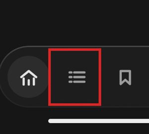
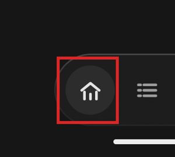
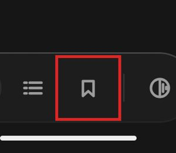
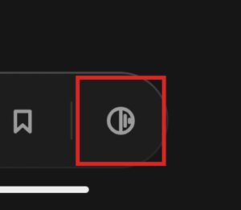
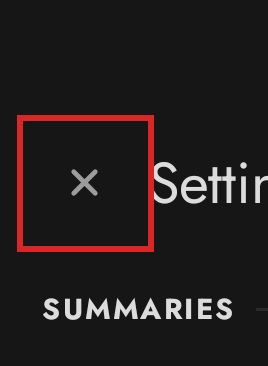
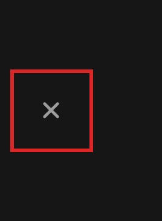
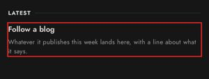
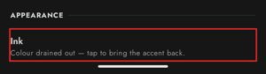
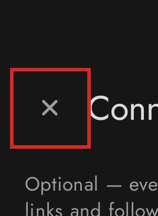
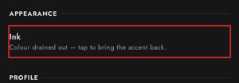

# Accessibility report: DuskRead

WCAG 2.2 Level AA · dev.mks.duskread 1.2.0 · Google sdk_gphone16k_arm64, Android 17 · run `duskread-20261013-023451` · generated 2026-10-12T21:11:14+00:00 by appscreenmap 0.1.0

> Automated results are evidence for a person to confirm, **not a conformance claim**. Per-screen scanner checks (labels, contrast) run in the web viewer; only confirmed ones are included (0 imported).

## Summary

| Status | Criteria |
|---|---|
| Fails | 0 of 55 |
| Issues found | 1 of 55 |
| Needs review | 1 of 55 |
| No issues detected | 13 of 55 |
| Check in viewer | 3 of 55 |
| Not tested | 37 of 55 |

## Findings by success criterion

### 3.2.3 Consistent Navigation (Level AA) — Issues found · advisory for native apps

The bottom navigation differs in order or content between screens.

**Fix:** Keep repeated navigation in the same relative order on every screen.

| Screen | Element | Detail | Status | Evidence |
|---|---|---|---|---|
| s004 · SAVED · 0 | bottom navigation | extra items vs. most screens: ['home', 'following', 'saved', 'switch to the colour theme'] | open (automated) |  |

[Understanding 3.2.3](https://www.w3.org/WAI/WCAG22/Understanding/consistent-navigation)

### 4.1.2 Name, Role, Value (Level A) — Needs review

A clickable generic View exposes no role, so TalkBack doesn't say it's a button, tab, or switch.

**Fix:** Use a real widget, or set the role: Modifier.semantics { role = Role.Button } / AccessibilityNodeInfo.setClassName.

| Screen | Element | Detail | Status | Evidence |
|---|---|---|---|---|
| 5 screens: s002, s003, s004, s005 +1 | Following | clickable android.view.View with no role | open (automated) |  |
| 5 screens: s002, s003, s004, s005 +1 | Home | clickable android.view.View with no role | open (automated) |  |
| 5 screens: s002, s003, s004, s005 +1 | Saved | clickable android.view.View with no role | open (automated) |  |
| 5 screens: s002, s003, s004, s005 +1 | Switch to the colour theme | clickable android.view.View with no role | open (automated) |  |
| 2 screens: s007, s011 | Close settings | clickable android.view.View with no role | open (automated) |  |
| 2 screens: s008, s009 | Close focus mode | clickable android.view.View with no role | open (automated) |  |
| s002 · Hello, test | Follow a blog Whatever it publishes this week lands here, wi | clickable android.view.View with no role | open (automated) |  |
| s007 · Settings | Ink Colour drained out — tap to bring the accent back. | clickable android.view.View with no role | open (automated) |  |
| s010 · Connect Notion | Close setup | clickable android.view.View with no role | open (automated) |  |
| s011 · Settings | Ink Colour drained out — tap to bring the accent back. | clickable android.view.View with no role | open (automated) |  |

[Understanding 4.1.2](https://www.w3.org/WAI/WCAG22/Understanding/name-role-value)

## All criteria (Level AA)

| Criterion | Level | Status | How checked |
|---|---|---|---|
| [1.1.1](https://www.w3.org/WAI/WCAG22/Understanding/non-text-content) Non-text Content | A | No issues detected | crawler |
| [1.2.1](https://www.w3.org/WAI/WCAG22/Understanding/audio-only-and-video-only-prerecorded) Audio-only and Video-only (Prerecorded) | A | Not tested | manual |
| [1.2.2](https://www.w3.org/WAI/WCAG22/Understanding/captions-prerecorded) Captions (Prerecorded) | A | Not tested | manual |
| [1.2.3](https://www.w3.org/WAI/WCAG22/Understanding/audio-description-or-media-alternative-prerecorded) Audio Description or Media Alternative (Prerecorded) | A | Not tested | manual |
| [1.2.4](https://www.w3.org/WAI/WCAG22/Understanding/captions-live) Captions (Live) | AA | Not tested | manual |
| [1.2.5](https://www.w3.org/WAI/WCAG22/Understanding/audio-description-prerecorded) Audio Description (Prerecorded) | AA | Not tested | manual |
| [1.3.1](https://www.w3.org/WAI/WCAG22/Understanding/info-and-relationships) Info and Relationships | A | Not tested | manual |
| [1.3.2](https://www.w3.org/WAI/WCAG22/Understanding/meaningful-sequence) Meaningful Sequence | A | Not tested | device |
| [1.3.3](https://www.w3.org/WAI/WCAG22/Understanding/sensory-characteristics) Sensory Characteristics | A | Not tested | manual |
| [1.3.4](https://www.w3.org/WAI/WCAG22/Understanding/orientation) Orientation | AA | No issues detected | crawler, device |
| [1.3.5](https://www.w3.org/WAI/WCAG22/Understanding/identify-input-purpose) Identify Input Purpose | AA | Not tested | manual |
| [1.4.1](https://www.w3.org/WAI/WCAG22/Understanding/use-of-color) Use of Color | A | Not tested | manual |
| [1.4.2](https://www.w3.org/WAI/WCAG22/Understanding/audio-control) Audio Control | A | Not tested | manual |
| [1.4.3](https://www.w3.org/WAI/WCAG22/Understanding/contrast-minimum) Contrast (Minimum) | AA | Check in viewer | viewer |
| [1.4.4](https://www.w3.org/WAI/WCAG22/Understanding/resize-text) Resize Text | AA | Not tested | crawler, device — needs a --font-scale 2.0 crawl |
| [1.4.5](https://www.w3.org/WAI/WCAG22/Understanding/images-of-text) Images of Text | AA | Not tested | manual |
| [1.4.10](https://www.w3.org/WAI/WCAG22/Understanding/reflow) Reflow | AA | Not tested | device |
| [1.4.11](https://www.w3.org/WAI/WCAG22/Understanding/non-text-contrast) Non-text Contrast | AA | Not tested | manual |
| [1.4.12](https://www.w3.org/WAI/WCAG22/Understanding/text-spacing) Text Spacing | AA | Not tested | manual |
| [1.4.13](https://www.w3.org/WAI/WCAG22/Understanding/content-on-hover-or-focus) Content on Hover or Focus | AA | Not tested | manual |
| [2.1.1](https://www.w3.org/WAI/WCAG22/Understanding/keyboard) Keyboard | A | No issues detected | crawler, device |
| [2.1.2](https://www.w3.org/WAI/WCAG22/Understanding/no-keyboard-trap) No Keyboard Trap | A | Not tested | device |
| [2.1.4](https://www.w3.org/WAI/WCAG22/Understanding/character-key-shortcuts) Character Key Shortcuts | A | Not tested | manual |
| [2.2.1](https://www.w3.org/WAI/WCAG22/Understanding/timing-adjustable) Timing Adjustable | A | Not tested | manual |
| [2.2.2](https://www.w3.org/WAI/WCAG22/Understanding/pause-stop-hide) Pause, Stop, Hide | A | Not tested | manual |
| [2.3.1](https://www.w3.org/WAI/WCAG22/Understanding/three-flashes-or-below-threshold) Three Flashes or Below Threshold | A | Not tested | manual |
| [2.4.1](https://www.w3.org/WAI/WCAG22/Understanding/bypass-blocks) Bypass Blocks *(advisory)* | A | Not tested | manual |
| [2.4.2](https://www.w3.org/WAI/WCAG22/Understanding/page-titled) Page Titled | A | No issues detected | crawler |
| [2.4.3](https://www.w3.org/WAI/WCAG22/Understanding/focus-order) Focus Order | A | Not tested | device |
| [2.4.4](https://www.w3.org/WAI/WCAG22/Understanding/link-purpose-in-context) Link Purpose (In Context) | A | Not tested | manual |
| [2.4.5](https://www.w3.org/WAI/WCAG22/Understanding/multiple-ways) Multiple Ways *(advisory)* | AA | Not tested | manual |
| [2.4.6](https://www.w3.org/WAI/WCAG22/Understanding/headings-and-labels) Headings and Labels | AA | Check in viewer | viewer |
| [2.4.7](https://www.w3.org/WAI/WCAG22/Understanding/focus-visible) Focus Visible | AA | Not tested | device |
| [2.4.11](https://www.w3.org/WAI/WCAG22/Understanding/focus-not-obscured-minimum) Focus Not Obscured (Minimum) *(2.2)* | AA | No issues detected | crawler, device |
| [2.5.1](https://www.w3.org/WAI/WCAG22/Understanding/pointer-gestures) Pointer Gestures | A | Not tested | manual |
| [2.5.2](https://www.w3.org/WAI/WCAG22/Understanding/pointer-cancellation) Pointer Cancellation | A | Not tested | manual |
| [2.5.3](https://www.w3.org/WAI/WCAG22/Understanding/label-in-name) Label in Name | A | No issues detected | crawler |
| [2.5.4](https://www.w3.org/WAI/WCAG22/Understanding/motion-actuation) Motion Actuation | A | Not tested | manual |
| [2.5.7](https://www.w3.org/WAI/WCAG22/Understanding/dragging-movements) Dragging Movements *(2.2)* | AA | No issues detected | crawler |
| [2.5.8](https://www.w3.org/WAI/WCAG22/Understanding/target-size-minimum) Target Size (Minimum) *(2.2)* | AA | No issues detected | crawler |
| [3.1.1](https://www.w3.org/WAI/WCAG22/Understanding/language-of-page) Language of Page | A | Not tested | manual |
| [3.1.2](https://www.w3.org/WAI/WCAG22/Understanding/language-of-parts) Language of Parts | AA | Not tested | manual |
| [3.2.1](https://www.w3.org/WAI/WCAG22/Understanding/on-focus) On Focus | A | Not tested | device |
| [3.2.2](https://www.w3.org/WAI/WCAG22/Understanding/on-input) On Input | A | No issues detected | crawler |
| [3.2.3](https://www.w3.org/WAI/WCAG22/Understanding/consistent-navigation) Consistent Navigation *(advisory)* | AA | Issues found (1) | crawler |
| [3.2.4](https://www.w3.org/WAI/WCAG22/Understanding/consistent-identification) Consistent Identification *(advisory)* | AA | No issues detected | crawler |
| [3.2.6](https://www.w3.org/WAI/WCAG22/Understanding/consistent-help) Consistent Help *(2.2)* *(advisory)* | A | No issues detected | crawler |
| [3.3.1](https://www.w3.org/WAI/WCAG22/Understanding/error-identification) Error Identification | A | Not tested | manual |
| [3.3.2](https://www.w3.org/WAI/WCAG22/Understanding/labels-or-instructions) Labels or Instructions | A | Check in viewer | viewer |
| [3.3.3](https://www.w3.org/WAI/WCAG22/Understanding/error-suggestion) Error Suggestion | AA | Not tested | manual |
| [3.3.4](https://www.w3.org/WAI/WCAG22/Understanding/error-prevention-legal-financial-data) Error Prevention (Legal, Financial, Data) | AA | Not tested | manual |
| [3.3.7](https://www.w3.org/WAI/WCAG22/Understanding/redundant-entry) Redundant Entry *(2.2)* | A | No issues detected | crawler |
| [3.3.8](https://www.w3.org/WAI/WCAG22/Understanding/accessible-authentication-minimum) Accessible Authentication (Minimum) *(2.2)* | AA | No issues detected | crawler |
| [4.1.2](https://www.w3.org/WAI/WCAG22/Understanding/name-role-value) Name, Role, Value | A | Needs review (28) | crawler, viewer |
| [4.1.3](https://www.w3.org/WAI/WCAG22/Understanding/status-messages) Status Messages | AA | Not tested | manual |

## Screens audited

- s001 · DuskRead
- s002 · Hello, test — 5 finding(s)
- s003 · FOLLOWING — 4 finding(s)
- s004 · SAVED · 0 — 5 finding(s)
- s005 · FOLLOWING — 4 finding(s)
- s006 · FOLLOWING — 4 finding(s)
- s007 · Settings — 2 finding(s)
- s008 · FOCUS · 15 MIN — 1 finding(s)
- s009 · FOCUS — 1 finding(s)
- s010 · Connect Notion — 1 finding(s)
- s011 · Settings — 2 finding(s)

## Method and limits

- Explored automatically on an emulator; unreached screens were not checked.
- Sizes in dp (≈ CSS px); density read from the device.
- *Not tested* criteria need device or manual testing (see the `a11y-audit` skill).
- 2.4.1, 2.4.5, 3.2.3, 3.2.4, 3.2.6 are advisory for a single native app under WCAG2ICT.
