# Accessibility report: Playground

WCAG 2.2 Level AA · dev.appscreenmap.playground 1.0 · Google sdk_gphone16k_arm64, Android 17 · run `playground-v1-20261013-024928` · generated 2026-10-12T21:29:05+00:00 by appscreenmap 0.1.0

> Automated results are evidence for a person to confirm, **not a conformance claim**. Per-screen scanner checks (labels, contrast) run in the web viewer; only confirmed ones are included (0 imported).

## Summary

| Status | Criteria |
|---|---|
| Fails | 0 of 55 |
| Issues found | 4 of 55 |
| Needs review | 4 of 55 |
| No issues detected | 7 of 55 |
| Check in viewer | 3 of 55 |
| Not tested | 37 of 55 |

## Findings by success criterion

### 1.3.4 Orientation (Level AA) — Issues found

The activity is locked to one orientation in the manifest.

**Fix:** Remove android:screenOrientation unless an orientation is essential (e.g. a piano app).

| Screen | Element | Detail | Status | Evidence |
|---|---|---|---|---|
| app · app | ScannerActivity | dev.appscreenmap.playground.ScannerActivity is locked to portrait | open (automated) |  |

[Understanding 1.3.4](https://www.w3.org/WAI/WCAG22/Understanding/orientation)

### 2.5.8 Target Size (Minimum) (Level AA) — Issues found · new in 2.2

A tappable target is smaller than 24×24 dp and too close to another target (the 24 dp spacing circles overlap).

**Fix:** Make the target at least 24×24 dp (48×48 dp is Android's guideline), or space targets so 24 dp circles around each don't overlap. Compose: Modifier.minimumInteractiveComponentSize().

| Screen | Element | Detail | Status | Evidence |
|---|---|---|---|---|
| s002 · Discover | article_card | 379×11 dp, within 24 dp spacing of 2 other target(s) | open (automated) | 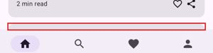 |
| s020 · Discover | article_card | 379×0 dp, within 24 dp spacing of 2 other target(s) | open (automated) |  |

[Understanding 2.5.8](https://www.w3.org/WAI/WCAG22/Understanding/target-size-minimum)

### 3.2.3 Consistent Navigation (Level AA) — Issues found · advisory for native apps

The bottom navigation differs in order or content between screens.

**Fix:** Keep repeated navigation in the same relative order on every screen.

| Screen | Element | Detail | Status | Evidence |
|---|---|---|---|---|
| 4 screens: s003, s006, s007, s021 | bottom navigation | missing ['search'] vs. most screens: ['search', 'library', 'profile'] | open (automated) |  |

[Understanding 3.2.3](https://www.w3.org/WAI/WCAG22/Understanding/consistent-navigation)

### 3.2.4 Consistent Identification (Level AA) — Issues found · advisory for native apps

The same control (same resource id) is labelled differently on different screens.

**Fix:** Use the same label for the same function everywhere.

| Screen | Element | Detail | Status | Evidence |
|---|---|---|---|---|
| s002 · Discover | article_card | labelled “article_card” on s002, s020; “a slow screen is a bug, even when it wor” on s002, s020; “a##y.example” on s002, s020; “the long title that does not fit on a si” on s002, s020; “# min read / share” on s020 | open (automated) |  |
| s008 · Account settings | primary_action | labelled “save” on s008; “submit” on s015 | open (automated) |  |

[Understanding 3.2.4](https://www.w3.org/WAI/WCAG22/Understanding/consistent-identification)

### 2.5.7 Dragging Movements (Level AA) — Needs review · new in 2.2

A slider, drag handle, or swipe-only control needs a single-tap alternative.

**Fix:** Add buttons (e.g. +/−, move up/down) or accessibility custom actions for anything done by dragging.

| Screen | Element | Detail | Status | Evidence |
|---|---|---|---|---|
| s010 · Text size | text_size_slider | slider: check there is a non-drag way to set the value | open (review) | 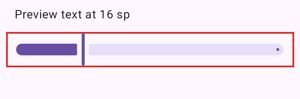 |

[Understanding 2.5.7](https://www.w3.org/WAI/WCAG22/Understanding/dragging-movements)

### 3.3.7 Redundant Entry (Level A) — Needs review · new in 2.2

The same information was typed on more than one screen of one flow.

**Fix:** Auto-fill information the user already gave, or let them select it.

| Screen | Element | Detail | Status | Evidence |
|---|---|---|---|---|
| s008 · Account settings | Email | also typed on s001 earlier in the path to s008 | open (review) |  |

[Understanding 3.3.7](https://www.w3.org/WAI/WCAG22/Understanding/redundant-entry)

### 3.3.8 Accessible Authentication (Minimum) (Level AA) — Needs review · new in 2.2

This screen asks for a password, code, or puzzle. Authentication must not depend on a cognitive test unless paste, password managers, or another method are supported.

**Fix:** Allow paste and autofill (autofillHints password/username/oneTimeCode), offer passkeys or email links, and avoid text CAPTCHAs.

| Screen | Element | Detail | Status | Evidence |
|---|---|---|---|---|
| s001 · Welcome back | Welcome back | password field: check paste/autofill and alternatives | open (review) |  |

[Understanding 3.3.8](https://www.w3.org/WAI/WCAG22/Understanding/accessible-authentication-minimum)

### 4.1.2 Name, Role, Value (Level A) — Needs review

A clickable generic View exposes no role, so TalkBack doesn't say it's a button, tab, or switch.

**Fix:** Use a real widget, or set the role: Modifier.semantics { role = Role.Button } / AccessibilityNodeInfo.setClassName.

| Screen | Element | Detail | Status | Evidence |
|---|---|---|---|---|
| 12 screens: s004, s005, s008, s009 +8 | Navigate up | clickable android.view.View with no role | open (automated) | 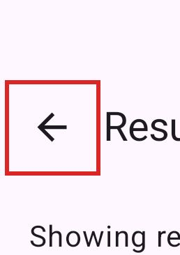 |
| 5 screens: s002, s003, s006, s020 +1 | Profile | clickable android.view.View with no role | open (automated) | 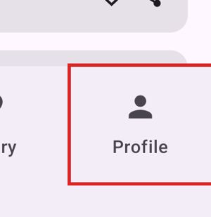 |
| 5 screens: s002, s006, s007, s020 +1 | Search | clickable android.view.View with no role | open (automated) | 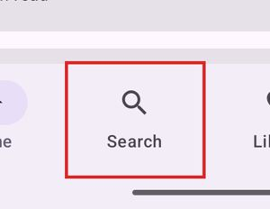 |
| 4 screens: s002, s003, s007, s020 | Library | clickable android.view.View with no role | open (automated) | 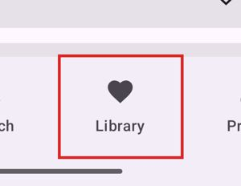 |
| 3 screens: s006, s007, s021 | Home | clickable android.view.View with no role | open (automated) | 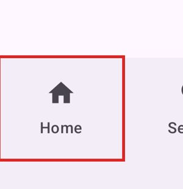 |
| 2 screens: s002, s020 | Help | clickable android.view.View with no role | open (automated) | 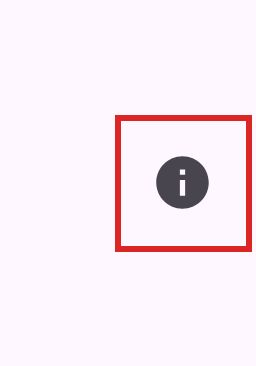 |
| 2 screens: s002, s020 | bookmark | clickable android.view.View with no role | open (automated) | 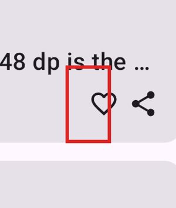 |
| s001 · Welcome back | Continue as guest | clickable android.view.View with no role | open (automated) | 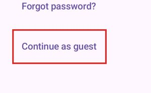 |
| s001 · Welcome back | Forgot password? | clickable android.view.View with no role | open (automated) | 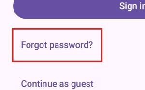 |
| s001 · Welcome back | Sign in | clickable android.view.View with no role | open (automated) | 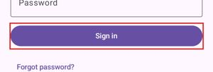 |
| s002 · Discover | Gallery | clickable android.view.View with no role | open (automated) | 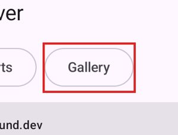 |
| s002 · Discover | Reports | clickable android.view.View with no role | open (automated) | 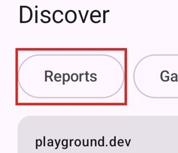 |
| s002 · Discover | a11y.example Label in name: say what you see 2 min read | clickable android.view.View with no role | open (automated) | 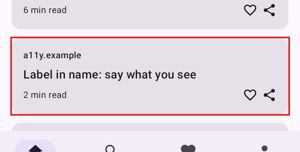 |
| s002 · Discover | article_card | clickable android.view.View with no role | open (automated) |  |
| s002 · Discover | bookmark | clickable android.view.View with no role | open (automated) | 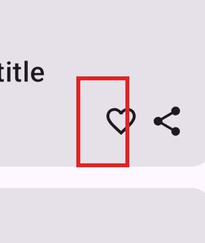 |
| s002 · Discover | bookmark | clickable android.view.View with no role | open (automated) | 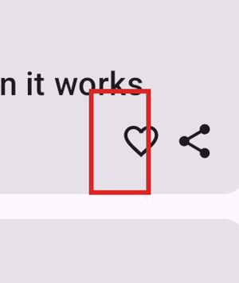 |
| s002 · Discover | bookmark | clickable android.view.View with no role | open (automated) | 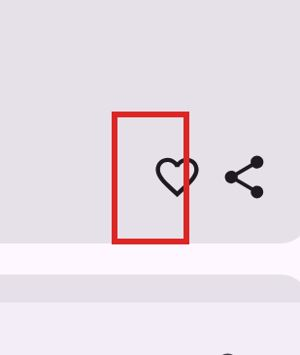 |
| s002 · Discover | bookmark | clickable android.view.View with no role | open (automated) | 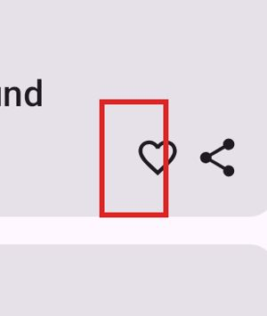 |
| s002 · Discover | design.example Touch targets: 24 dp is the floor, 48 dp is t | clickable android.view.View with no role | open (automated) | 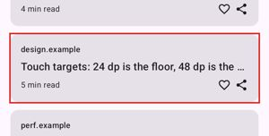 |
| s002 · Discover | notes.example Why every screen should have a title 4 min rea | clickable android.view.View with no role | open (automated) | 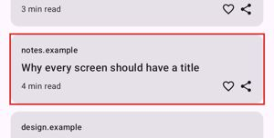 |
| s002 · Discover | perf.example A slow screen is a bug, even when it works 6 mi | clickable android.view.View with no role | open (automated) | 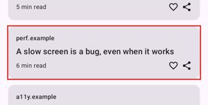 |
| s002 · Discover | playground.dev Getting started with the Playground 3 min rea | clickable android.view.View with no role | open (automated) | 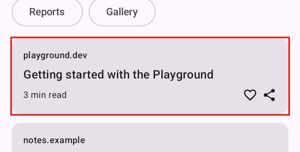 |
| s003 · Search | Home | clickable android.view.View with no role | open (automated) | 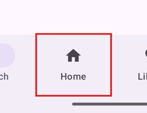 |
| s003 · Search | contrast | clickable android.view.View with no role | open (automated) | 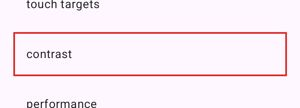 |
| s003 · Search | performance | clickable android.view.View with no role | open (automated) | 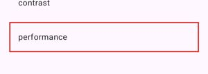 |
| s003 · Search | touch targets | clickable android.view.View with no role | open (automated) | 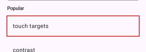 |
| s004 · Results | Getting started with the Playground playground.dev | clickable android.view.View with no role | open (automated) | 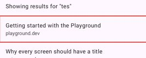 |
| s004 · Results | Touch targets: 24 dp is the floor, 48 dp is the goal design. | clickable android.view.View with no role | open (automated) | 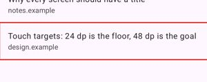 |
| s004 · Results | Why every screen should have a title notes.example | clickable android.view.View with no role | open (automated) | 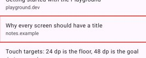 |
| s005 · Article | Listen | clickable android.view.View with no role | open (automated) | 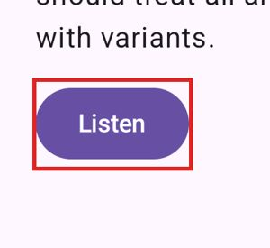 |
| s006 · Library | Browse articles | clickable android.view.View with no role | open (automated) | 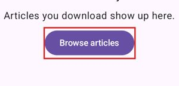 |
| s006 · Library | History | clickable android.view.View with no role | open (automated) | 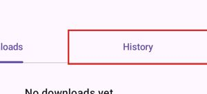 |
| s007 · Profile | Account settings | clickable android.view.View with no role | open (automated) | 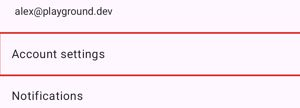 |
| s007 · Profile | Developer options | clickable android.view.View with no role | open (automated) | 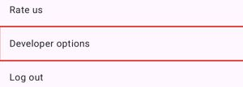 |
| s007 · Profile | Help | clickable android.view.View with no role | open (automated) | 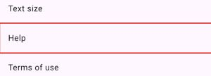 |
| s007 · Profile | Log out | clickable android.view.View with no role | open (automated) | 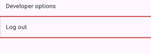 |
| s007 · Profile | Notifications | clickable android.view.View with no role | open (automated) | 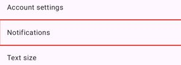 |
| s007 · Profile | Privacy policy | clickable android.view.View with no role | open (automated) | 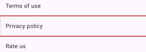 |
| s007 · Profile | Rate us | clickable android.view.View with no role | open (automated) | 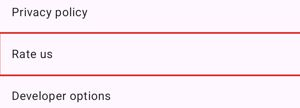 |
| s007 · Profile | Terms of use | clickable android.view.View with no role | open (automated) | 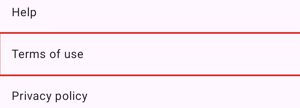 |
| s007 · Profile | Text size | clickable android.view.View with no role | open (automated) | 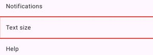 |
| s008 · Account settings | Delete account | clickable android.view.View with no role | open (automated) | 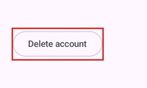 |
| s008 · Account settings | Save | clickable android.view.View with no role | open (automated) | 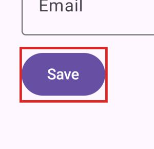 |
| s009 · Notifications | Allow notifications | clickable android.view.View with no role | open (automated) | 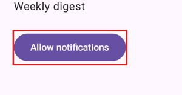 |
| s011 · Help | Contact support | clickable android.view.View with no role | open (automated) | 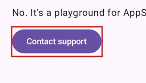 |
| s013 · Enjoying Playground? | Not now | clickable android.view.View with no role | open (automated) | 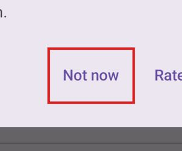 |
| s013 · Enjoying Playground? | Rate 5 stars | clickable android.view.View with no role | open (automated) | 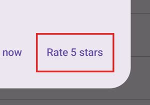 |
| s014 · Developer options | Crash the app | clickable android.view.View with no role | open (automated) | 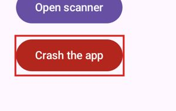 |
| s014 · Developer options | Open scanner | clickable android.view.View with no role | open (automated) | 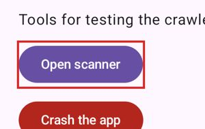 |
| s015 · Feedback | Submit | clickable android.view.View with no role | open (automated) |  |
| s016 · Terms of use | Read more | clickable android.view.View with no role | open (automated) |  |
| s017 · Scanner | Close scanner | clickable android.view.View with no role | open (automated) |  |
| s020 · Discover | The long title that does not fit on a single line of a phone | clickable android.view.View with no role | open (automated) |  |
| s020 · Discover | a11y.example Dragging is optional, buttons are not 3 min rea | clickable android.view.View with no role | open (automated) |  |
| s020 · Discover | article_card | clickable android.view.View with no role | open (automated) |  |
| s020 · Discover | bookmark | clickable android.view.View with no role | open (automated) |  |
| s020 · Discover | bookmark | clickable android.view.View with no role | open (automated) |  |
| s020 · Discover | bookmark | clickable android.view.View with no role | open (automated) |  |
| s020 · Discover | bookmark | clickable android.view.View with no role | open (automated) |  |
| s020 · Discover | bookmark | clickable android.view.View with no role | open (automated) |  |
| s020 · Discover | design.example Consistent navigation, one bar everywhere 3 m | clickable android.view.View with no role | open (automated) |  |
| s020 · Discover | notes.example Orientation: let people turn their phone 2 min | clickable android.view.View with no role | open (automated) |  |
| s020 · Discover | perf.example Frames, jank and the 16 millisecond budget 8 mi | clickable android.view.View with no role | open (automated) |  |
| s020 · Discover | playground.dev Forms that do not ask twice 4 min read | clickable android.view.View with no role | open (automated) |  |
| s021 · Library | A slow screen is a bug, even when it works Read yesterday | clickable android.view.View with no role | open (automated) |  |
| s021 · Library | Downloads | clickable android.view.View with no role | open (automated) |  |
| s021 · Library | Getting started with the Playground Read yesterday | clickable android.view.View with no role | open (automated) |  |
| s021 · Library | Label in name: say what you see Read yesterday | clickable android.view.View with no role | open (automated) |  |
| s021 · Library | Touch targets: 24 dp is the floor, 48 dp is the goal Read ye | clickable android.view.View with no role | open (automated) |  |
| s021 · Library | Why every screen should have a title Read yesterday | clickable android.view.View with no role | open (automated) |  |

[Understanding 4.1.2](https://www.w3.org/WAI/WCAG22/Understanding/name-role-value)

## All criteria (Level AA)

| Criterion | Level | Status | How checked |
|---|---|---|---|
| [1.1.1](https://www.w3.org/WAI/WCAG22/Understanding/non-text-content) Non-text Content | A | No issues detected | crawler |
| [1.2.1](https://www.w3.org/WAI/WCAG22/Understanding/audio-only-and-video-only-prerecorded) Audio-only and Video-only (Prerecorded) | A | Not tested | manual |
| [1.2.2](https://www.w3.org/WAI/WCAG22/Understanding/captions-prerecorded) Captions (Prerecorded) | A | Not tested | manual |
| [1.2.3](https://www.w3.org/WAI/WCAG22/Understanding/audio-description-or-media-alternative-prerecorded) Audio Description or Media Alternative (Prerecorded) | A | Not tested | manual |
| [1.2.4](https://www.w3.org/WAI/WCAG22/Understanding/captions-live) Captions (Live) | AA | Not tested | manual |
| [1.2.5](https://www.w3.org/WAI/WCAG22/Understanding/audio-description-prerecorded) Audio Description (Prerecorded) | AA | Not tested | manual |
| [1.3.1](https://www.w3.org/WAI/WCAG22/Understanding/info-and-relationships) Info and Relationships | A | Not tested | manual |
| [1.3.2](https://www.w3.org/WAI/WCAG22/Understanding/meaningful-sequence) Meaningful Sequence | A | Not tested | device |
| [1.3.3](https://www.w3.org/WAI/WCAG22/Understanding/sensory-characteristics) Sensory Characteristics | A | Not tested | manual |
| [1.3.4](https://www.w3.org/WAI/WCAG22/Understanding/orientation) Orientation | AA | Issues found (1) | crawler, device |
| [1.3.5](https://www.w3.org/WAI/WCAG22/Understanding/identify-input-purpose) Identify Input Purpose | AA | Not tested | manual |
| [1.4.1](https://www.w3.org/WAI/WCAG22/Understanding/use-of-color) Use of Color | A | Not tested | manual |
| [1.4.2](https://www.w3.org/WAI/WCAG22/Understanding/audio-control) Audio Control | A | Not tested | manual |
| [1.4.3](https://www.w3.org/WAI/WCAG22/Understanding/contrast-minimum) Contrast (Minimum) | AA | Check in viewer | viewer |
| [1.4.4](https://www.w3.org/WAI/WCAG22/Understanding/resize-text) Resize Text | AA | Not tested | crawler, device — needs a --font-scale 2.0 crawl |
| [1.4.5](https://www.w3.org/WAI/WCAG22/Understanding/images-of-text) Images of Text | AA | Not tested | manual |
| [1.4.10](https://www.w3.org/WAI/WCAG22/Understanding/reflow) Reflow | AA | Not tested | device |
| [1.4.11](https://www.w3.org/WAI/WCAG22/Understanding/non-text-contrast) Non-text Contrast | AA | Not tested | manual |
| [1.4.12](https://www.w3.org/WAI/WCAG22/Understanding/text-spacing) Text Spacing | AA | Not tested | manual |
| [1.4.13](https://www.w3.org/WAI/WCAG22/Understanding/content-on-hover-or-focus) Content on Hover or Focus | AA | Not tested | manual |
| [2.1.1](https://www.w3.org/WAI/WCAG22/Understanding/keyboard) Keyboard | A | No issues detected | crawler, device |
| [2.1.2](https://www.w3.org/WAI/WCAG22/Understanding/no-keyboard-trap) No Keyboard Trap | A | Not tested | device |
| [2.1.4](https://www.w3.org/WAI/WCAG22/Understanding/character-key-shortcuts) Character Key Shortcuts | A | Not tested | manual |
| [2.2.1](https://www.w3.org/WAI/WCAG22/Understanding/timing-adjustable) Timing Adjustable | A | Not tested | manual |
| [2.2.2](https://www.w3.org/WAI/WCAG22/Understanding/pause-stop-hide) Pause, Stop, Hide | A | Not tested | manual |
| [2.3.1](https://www.w3.org/WAI/WCAG22/Understanding/three-flashes-or-below-threshold) Three Flashes or Below Threshold | A | Not tested | manual |
| [2.4.1](https://www.w3.org/WAI/WCAG22/Understanding/bypass-blocks) Bypass Blocks *(advisory)* | A | Not tested | manual |
| [2.4.2](https://www.w3.org/WAI/WCAG22/Understanding/page-titled) Page Titled | A | No issues detected | crawler |
| [2.4.3](https://www.w3.org/WAI/WCAG22/Understanding/focus-order) Focus Order | A | Not tested | device |
| [2.4.4](https://www.w3.org/WAI/WCAG22/Understanding/link-purpose-in-context) Link Purpose (In Context) | A | Not tested | manual |
| [2.4.5](https://www.w3.org/WAI/WCAG22/Understanding/multiple-ways) Multiple Ways *(advisory)* | AA | Not tested | manual |
| [2.4.6](https://www.w3.org/WAI/WCAG22/Understanding/headings-and-labels) Headings and Labels | AA | Check in viewer | viewer |
| [2.4.7](https://www.w3.org/WAI/WCAG22/Understanding/focus-visible) Focus Visible | AA | Not tested | device |
| [2.4.11](https://www.w3.org/WAI/WCAG22/Understanding/focus-not-obscured-minimum) Focus Not Obscured (Minimum) *(2.2)* | AA | No issues detected | crawler, device |
| [2.5.1](https://www.w3.org/WAI/WCAG22/Understanding/pointer-gestures) Pointer Gestures | A | Not tested | manual |
| [2.5.2](https://www.w3.org/WAI/WCAG22/Understanding/pointer-cancellation) Pointer Cancellation | A | Not tested | manual |
| [2.5.3](https://www.w3.org/WAI/WCAG22/Understanding/label-in-name) Label in Name | A | No issues detected | crawler |
| [2.5.4](https://www.w3.org/WAI/WCAG22/Understanding/motion-actuation) Motion Actuation | A | Not tested | manual |
| [2.5.7](https://www.w3.org/WAI/WCAG22/Understanding/dragging-movements) Dragging Movements *(2.2)* | AA | Needs review (1) | crawler |
| [2.5.8](https://www.w3.org/WAI/WCAG22/Understanding/target-size-minimum) Target Size (Minimum) *(2.2)* | AA | Issues found (2) | crawler |
| [3.1.1](https://www.w3.org/WAI/WCAG22/Understanding/language-of-page) Language of Page | A | Not tested | manual |
| [3.1.2](https://www.w3.org/WAI/WCAG22/Understanding/language-of-parts) Language of Parts | AA | Not tested | manual |
| [3.2.1](https://www.w3.org/WAI/WCAG22/Understanding/on-focus) On Focus | A | Not tested | device |
| [3.2.2](https://www.w3.org/WAI/WCAG22/Understanding/on-input) On Input | A | No issues detected | crawler |
| [3.2.3](https://www.w3.org/WAI/WCAG22/Understanding/consistent-navigation) Consistent Navigation *(advisory)* | AA | Issues found (4) | crawler |
| [3.2.4](https://www.w3.org/WAI/WCAG22/Understanding/consistent-identification) Consistent Identification *(advisory)* | AA | Issues found (2) | crawler |
| [3.2.6](https://www.w3.org/WAI/WCAG22/Understanding/consistent-help) Consistent Help *(2.2)* *(advisory)* | A | No issues detected | crawler |
| [3.3.1](https://www.w3.org/WAI/WCAG22/Understanding/error-identification) Error Identification | A | Not tested | manual |
| [3.3.2](https://www.w3.org/WAI/WCAG22/Understanding/labels-or-instructions) Labels or Instructions | A | Check in viewer | viewer |
| [3.3.3](https://www.w3.org/WAI/WCAG22/Understanding/error-suggestion) Error Suggestion | AA | Not tested | manual |
| [3.3.4](https://www.w3.org/WAI/WCAG22/Understanding/error-prevention-legal-financial-data) Error Prevention (Legal, Financial, Data) | AA | Not tested | manual |
| [3.3.7](https://www.w3.org/WAI/WCAG22/Understanding/redundant-entry) Redundant Entry *(2.2)* | A | Needs review (1) | crawler |
| [3.3.8](https://www.w3.org/WAI/WCAG22/Understanding/accessible-authentication-minimum) Accessible Authentication (Minimum) *(2.2)* | AA | Needs review (1) | crawler |
| [4.1.2](https://www.w3.org/WAI/WCAG22/Understanding/name-role-value) Name, Role, Value | A | Needs review (96) | crawler, viewer |
| [4.1.3](https://www.w3.org/WAI/WCAG22/Understanding/status-messages) Status Messages | AA | Not tested | manual |

## Screens audited

- s001 · Welcome back — 4 finding(s)
- s002 · Discover — 19 finding(s)
- s003 · Search — 7 finding(s)
- s004 · Results — 4 finding(s)
- s005 · Article — 2 finding(s)
- s006 · Library — 6 finding(s)
- s007 · Profile — 13 finding(s)
- s008 · Account settings — 5 finding(s)
- s009 · Notifications — 2 finding(s)
- s010 · Text size — 2 finding(s)
- s011 · Help — 2 finding(s)
- s012 · Terms of use — 1 finding(s)
- s013 · Enjoying Playground? — 2 finding(s)
- s014 · Developer options — 3 finding(s)
- s015 · Feedback — 2 finding(s)
- s016 · Terms of use — 2 finding(s)
- s017 · Scanner — 1 finding(s)
- s018 · Reports — 1 finding(s)
- s019 · Gallery — 1 finding(s)
- s020 · Discover — 18 finding(s)
- s021 · Library — 10 finding(s)

## Method and limits

- Explored automatically on an emulator; unreached screens were not checked.
- Sizes in dp (≈ CSS px); density read from the device.
- *Not tested* criteria need device or manual testing (see the `a11y-audit` skill).
- 2.4.1, 2.4.5, 3.2.3, 3.2.4, 3.2.6 are advisory for a single native app under WCAG2ICT.
